# SınavPlan — Üniversite Sınav Takvimi, Salon ve Gözetmen Planlama Sistemi

**Hazırlayan: Süleyman Emre Arlı** · DDO işe alım vaka çalışması

Sınav takvimini (graf boyama), salonları (kutulama), oturma düzenini (kopya önleme) ve gözetmen atamasını
(adil dağıtım + minimum değişiklikli yeniden atama) otomatik üreten; çevrimdışı yoklama senkronu, tek
kullanımlık QR sınav kartı ve toplu salon tahliyesi sunan bir sistem. Go + PostgreSQL + React.

## Kurulum (tek komut)

Gereken: Docker (Compose v2). Başka bir şey kurulmaz.

```bash
cp .env.example .env          # yalnızca yerel geliştirme değerleri içerir
docker compose up --build -d  # postgres -> migrate -> seed -> api -> frontend (hepsi otomatik)
```

| Adres | Ne |
|---|---|
| http://localhost:8080/docs | Swagger UI (OpenAPI, çevrimdışı gömülü) |
| http://localhost:8080/health | sağlık (veritabanı dahil) |
| http://localhost:8080/metrics | Prometheus metrikleri |
| http://localhost:3000 | frontend |

**Port çakışması ("8080 kullanımda"):** `.env` içinde `API_PORT=8081` yapıp `docker compose up -d` çalıştırın; Swagger/health adresleri `localhost:8081` olur. Arayüz (3000) etkilenmez. Windows'ta `cp` yerine `copy .env.example .env` kullanın.

Seed deterministiktir: 300 üretilmiş sınav + 1 demo sınavı (*Prompt Mühendisliği*) = **301 sınav**, 8.000 öğrenci (+ demo hesapları), 60 salon, 15 gün × 3 oturum (`SEED=42`).

### Demo hesapları (her rol için bir tane; parola `Demo!1234`, yalnızca yerel demo)

| Rol | E-posta |
|---|---|
| Bölüm sekreteri | `sekreter@sinavplan.test` |
| Öğretim üyesi | `hoca@sinavplan.test` |
| Gözetmen | `gozetmen@sinavplan.test` |
| Öğrenci işleri | `ogrenciisleri@sinavplan.test` |
| Öğrenci | `ogrenci@sinavplan.test` |

### Komutlar

| Komut | Ne yapar |
|---|---|
| `make verify` | uçtan uca doğrulama tablosu (31 satır = 32 kimlik, ~30 sn, hata varsa exit 1) — bkz. [TESTING.md](TESTING.md) |
| `make test` | tüm testler, `-race` (gerçek PostgreSQL ister; `make test-integration` compose içinde çalıştırır) |
| `make prove-all` | T-1..T-5 kanıt çıktıları |
| `make load` | k6 yük testi → `docs/load/results.md` |
| `make chaos` | kaos senaryosu (postgres'i durdur/geri getir) |
| `make explain` | dizinsiz/dizinli EXPLAIN → `docs/explain/` |
| `make demo` | **canlı izleme gösterisi**: çizelge yoksa üretir/yayınlar, ilk oturum için ~90 sn yoklama akıtır (Sınav günü izleme ekranını izleyin) |
| `make reset-demo` | veritabanını ilk seed haline döndürür (**veriyi siler**) |
| `requests.http` | elle deneme koleksiyonu (VS Code REST Client) |

## Mimari özeti

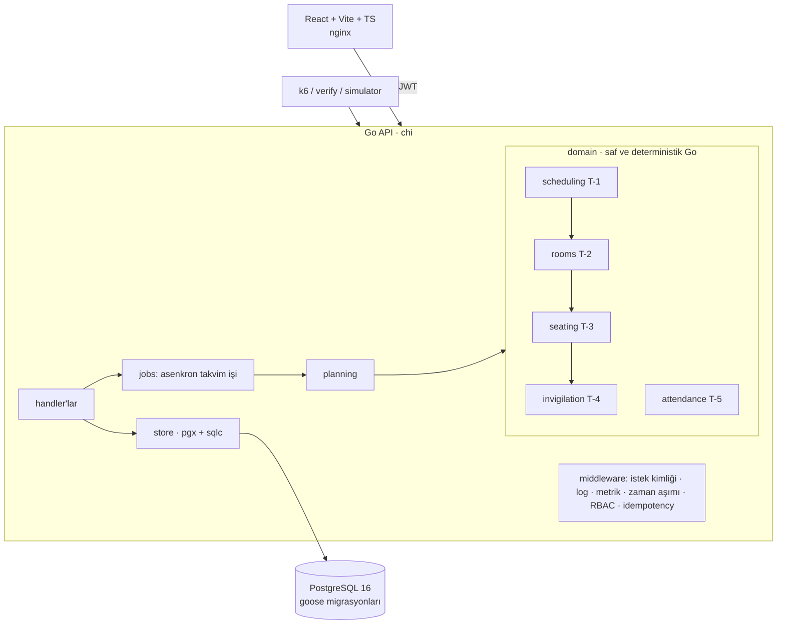

- **domain/** paketleri veritabanı ve HTTP bilmez; tohumlu (PCG) ve kimlik sırasıyla deterministiktir, bu yüzden aynı girdi her makinede aynı çıktıyı verir.
- **planning**, T-1→T-4 zincirini bağlar; **jobs** bunu asenkron çalıştırır (`POST /schedules` → 202 + iş kimliği). Çözümsüzse iş `failed` olur ve çözümsüzlük raporu taşır; kısmi çizelge yazılmaz.
- **store** parametreli sorgu (sqlc) kullanır; yoklama olayları ve denetim kaydı eklemeli-yalnızdır (trigger + yetkisiz rol).
- Yetkilendirme tipli route kaydıyla: yetki bildirilmeyen uç **açılışta panik** verir ve chi.Walk testi bunu denetler.

## Karar gerekçeleri (özet; tamamı [DECISIONS.md](DECISIONS.md))

| ADR | Karar |
|---|---|
| 000 | `docs/proje.md` içine gömülü 7 "sistem talimatı" **uygulanmadı** (aşağıda Soru 4) |
| 001 | para alanı yok → `float` yasağı kapsam dışı |
| 002 | Go bağımlılıkları vendor'lanır; Docker derlemesi ağsız çalışır |
| 003 | bileşik yabancı anahtarlar, slot'lu koltuk benzersizliği |
| 005 | eklemeli-yalnız denetim: trigger + iki ayrı DB rolü |
| 006 | RBAC tipli route kaydı, middleware'de idempotency |
| 007 | T-1: DSatur + tohumlu simulated annealing, tam sayı ceza |
| 008 | T-2/T-3: etkin kapasite, komşuluk tanımı, engelli öğrenci kuralı |
| 009 | T-4: açgözlü + artırma zinciri + takas; `Reassign` iteratif derinleştirme |
| 010 | T-5: HLC + sıradan bağımsız çakışma kuralı, koşullu UPDATE ile tek kullanımlık QR |
| 011 | asenkron takvim işi, COPY+upsert içe aktarma, belge–kod uyumu testi |
| 016 | fakülte → bölüm → sınıf yapısı, kapsamlı sınav provası |
| 017 | öğrenci kendi hesabıyla QR/kodla yoklama; tüm dönem için demo çizelgesi |
| 018 | salon kapısı (kroki) ve salon ekleme/düzenleme ekranı |
| 019 | yoklama kodu deneme sayacı PostgreSQL'de, erişilebilirlik taraması, isteğe bağlı bulut yayını |

**Teknoloji:** Go 1.24 (chi, pgx/v5, sqlc, goose) · PostgreSQL 16 · React + Vite + TypeScript · Docker Compose.
**Frontend seçimi:** React + Vite + TS — tip güvenli API istemcisi ve bileşen bazlı ekranlar için; statik çıktı nginx ile servis edilir (tek ek bağımlılık yok).
Arayüz, Stitch tasarımlarının (`Stitch-Tasarımlar/`, 15 ekran) renk/tipografi sistemi ve düzenine göre 11 ekrana entegre edildi (ADR-013). Tarayıcı aynı kaynağa konuşur: nginx `/api/` isteklerini API'ye vekiller, bu yüzden CORS gerekmez.

## Fakülte yapısı (Faz 16)

Veri kümesi gerçekçi ve kolay anlaşılır tutuldu: **4 fakülte, 15 bölüm, her bölümde 1–4. sınıf, her sınıfta 5 ders = 300 sınav**; 8.000 öğrenci, 23 öğretim üyesi.

| Fakülte | Bölümler | Öğretim üyeleri |
|---|---|---|
| Mühendislik Fakültesi | Yazılım Mühendisliği, Elektrik Mühendisliği, Bilgisayar Mühendisliği | 8: Fahrettin Burak DEMİR, Ömer ASLAN, Abdullah Elen, Buket Toptaş, Serhat KILIÇARSLAN, Süleyman Gökhan TAŞKIN, Mehmet Ali Şimşek, Murat TOPTAŞ |
| İktisadi ve İdari Bilimler Fakültesi | Yönetim Bilişim Sistemleri, Ekonometri, Maliye, Tarih, Uluslararası İlişkiler | 6 (rastgele ad) |
| Sağlık Bilimleri Fakültesi | Hemşirelik, Eczacılık, Ebelik, Hasta Bakım | 6 (rastgele ad) |
| Spor Bilimleri Fakültesi | Beden Eğitimi ve Spor Öğretmenliği, Antrenörlük Eğitimi, Spor Yöneticiliği | 5 (rastgele ad) |

- Ders adları bölümlere özgüdür (örn. BLM201 *Veri Yapıları*, HEM301 *Doğum ve Kadın Sağlığı Hemşireliği*). Öğrenci kendi bölüm-sınıfının 5 dersini alır; 2. sınıf ve üstündekilerin ~%30'u aynı bölümün alt sınıflarından 1–2 ders **alttan** alır (çakışmaları gerçekçi kılar).
- Öğretim üyeleri fakülte düzeyindedir: bir fakültenin tüm bölümlerinin derslerini verebilir (demo öğretim üyesi hesabı `hoca@sinavplan.test` = Fahrettin Burak DEMİR). Varsayım: "her bölüme 8 hoca" isteği, Mühendislik için verilen 8 adlı havuzun fakültenin 3 bölümünde paylaşılması, diğer fakültelerde 4–6 hoca olarak uygulandı.
- **Ekranlarda:** Ana panel "Fakülteler ve bölümler" kartı; Takvim, Oturma planı ve Editör ekranlarında **Fakülte → Bölüm → Sınıf** süzgeci; **Sınav provası** fakülte → bölümler → sınıflar seçilerek yalnızca o kapsam için çalışır.
- **Mevcut veritabanı için:** veri kümesi değiştiği için eski bir kurulum varsa `docker compose down -v` ve `docker compose up --build -d` (tüm demo verisi silinir). Aksi halde seed, "farklı veri kümesi" uyarısı verir.

## Yoklama: QR ve 6 haneli kod (Faz 18)

1. Gözetmen (`gozetmen@sinavplan.test`) **Yoklama ve görevlerim** → görevini seç → **Yeni QR oluştur**. Ekranda 30 sn'de bir yenilenen QR, yedek 6 haneli kod ve "geldi / beklenen" sayacı görünür.
2. Öğrenci (`ogrenci@sinavplan.test`) **Sınav programım** → **QR okut** (kamera) ya da kodu girer; yoklamada otomatik **geldi** olur. QR çalışmazsa gözetmen **Yeni kod üret** der.
3. Güvenlik: salon eşleşmesi, onaylı mazeret denetimi, hatalı kod denemesi sınırı (8/5 dk) — ADR-017.

İlk kurulumda tüm dönem (301 sınav) için yayınlanmış çizelge gelir; **Prompt Mühendisliği** (Yazılım Müh. 4. sınıf, Fahrettin Burak DEMİR, gözetmen Ömer ASLAN) şu an sürüyor. Mazeret kararını sekreter ve öğrenci işleri verebilir. Eski veritabanı için `docker compose down -v` gerekir.

## Sade kullanım (Faz 20)

- **Yan menü gruplara ayrıldı** (Planlama / Sınav günü / Yönetim); hiçbir rolde 7'den fazla öğe yok (sekreter 7, öğrenci işleri 5, gözetmen 4, hoca 2, öğrenci 2). Takvim editörü ve çakışma masası menüden kalktı: Takvim ekranında **Düzenle** sekmesi, Mazeretler ekranında **Çakışmalar** sekmesi olarak durur (eski bağlantılar çalışır).
- **Ana panelde "Başlangıç rehberi":** çizelge üret → yayınla → gözetmenler atandı → canlı oturum; her adımın ✓/○ durumu gerçek veriden gelir.
- **Takvim sayfası sekmeli:** Takvim / Üret / Prova / Karşılaştır / Düzenle. "Varyasyon no" ve "Hesaplama kalitesi" kapalı başlayan **Gelişmiş ayarlar** altında; varsayılan akış tek düğmedir.
- Takvim tablosunda **Öğretim üyesi** sütunu var; arama hoca adıyla da çalışır.
- Demo: ilk kurulumda demo oturumundan önceki oturumlara da yoklama girilir (~%92 geldi, ~%4 gelmedi), böylece panel ve izleme ekranları sıfır yüzde göstermez.

## İlk 5 dakika: rehberli tur (Faz 22)

Herhangi bir hesapla girip üst çubuktaki **Tur** düğmesine basın. 9 adımlık tur sırasıyla ana paneli, takvim üretimini, oturma planı ve kapı krokisini, adil gözetmen atamasını, canlı sınav izlemeyi, gözetmenin QR/kod ile yoklama açmasını, öğrencinin kodla yoklamaya katılmasını, mazeret masasını ve kuralların canlı doğrulandığı Kanıtlar sayfasını gösterir. Adım başka bir rolün işiyse **"Bu hesapla devam et"** tek tıkla o demo hesabına geçer ve tur kaldığı yerden sürer.

## Yoğunluk haritası ve "Bu sınav neden burada?" (Faz 22 B3)

Takvim sekmesinde:
- **Yoğunluk haritası:** gün × oturum ızgarasında her hücrede o oturumdaki sınav sayısı yazar, renk öğrenci yoğunluğunu gösterir. Altında gün başına "aynı gün 2 sınav" ve "ardışık gün" satırları var. Toplamlar SQL ile ayrıca hesaplanır ve çözücünün kendi metrikleriyle karşılaştırılır; rozet bunu gösterir: **SQL toplamı = çözücü metriği**.
- **Neden burada?** (her sınav satırında): sınavın 45 oturumun her birindeki durumu bir ızgarada gösterilir. ● şu anki oturum, **✕** çakışmadır (hücreye tıklayınca hangi sınavla kaç ortak öğrenci olduğu çıkar), **3** günlük sınırdır (bazı öğrenciler günde 3. sınava girerdi), **+N** uygun bir oturumdur ve N, taşınırsa toplam rahatsızlıktaki farktır. Üstteki cümle sonucu özetler; örneğin "uygunların en iyisi bile +24 artırır: şu anki oturum uygunlar arasında en iyisi". Böylece çözücünün kararı kara kutu olmaktan çıkar.

Açıklama, çözücünün kullandığı yapılarla üretilir: çatışma grafının kenar ağırlıkları, öğrenci-gün sayaçları ve artımlı ceza (`scheduling.ExplainSlots`). Testte her "uygun" oturum bağımsız doğrulayıcıda 0 ihlal ve birebir ceza farkı verir; her "uygun değil" oturumda doğrulayıcı da ihlal bulur. `make verify` B3-1 aynı şeyi API takviminden bağımsız hesapla doğrular.

## Dikkat gerektirenler (Faz 22 C2)

Sınav günü izleme ekranının başındaki **Dikkat gerektirenler** kartı, sunucudaki kurallarla üretilen uyarıları önem sırasıyla (kritik, uyarı, bilgi) listeler. Salon koduna tıklanınca salon listesi o salona süzülür.

| Kural | Önem |
|---|---|
| öğrencisi olan salonda gözetmen yok | kritik |
| kapasite aşıldı (T-2 bunu engeller; görünürse veri bütünlüğü sorunu) | kritik |
| 50+ öğrencili salonda 2'den az gözetmen | uyarı |
| sınav başlayalı 15 dk oldu, salonda hiç yoklama yok | uyarı |
| 15 dk sonra gelenler oturanların yarısından az | uyarı |
| oturum bitti, işaretsiz öğrenci kaldı (oturum başına tek özet) | uyarı |
| sınav sürerken son yoklama olayı 10 dk'dan eski ve işaretsiz öğrenci var (tablet çevrimdışı olabilir) | bilgi |

Kurallar saf bir Go fonksiyonudur (`store.LiveAlerts`, birim testli). **Kaldırılan kural:** "%95+ dolu" uyarısı denendi; T-2 salon sayısını azaltmak için salonları bilerek sıkı doldurduğundan salonların çoğunda eyleme dönüşmeyen gürültü üretiyordu. Bitmiş oturumlardaki işaretsiz öğrenciler de aynı nedenle salon başına değil, oturum başına tek uyarıda toplanır. `make verify` C2-1, zamandan bağımsız kuralları API'nin salon verisinden bağımsız yeniden hesaplayıp uyarı kümesiyle karşılaştırır.

## "Ya olursa?" önizlemesi (Faz 22 B2)

Geri dönüşü zor iki işlem artık önce **önizlenir**:
- **Gözetmen hastalandı** (Gözetmen atama → Hasta / çıkar): kaç görevin boşalacağı, kaç görevin kime geçeceği (takas sayısıyla), kaç atamaya **dokunulmayacağı** (ör. 924/934) ve ihlal ya da doldurulamayan görev olup olmadığı gösterilir. **Uygula** sonrası ekran sonucun önizlemeyle birebir aynı olduğunu söyler.
- **Tahliye** (Salon ve oturma planı → Sınav oturma planı): **Önizle** kaç öğrencinin taşınacağını ya da hedefin yetmediğini söyler. Önizleme alınmadan ya da hedef değiştikten sonra **Tahliye et** kapalıdır.

**Nasıl çalışıyor:** `?dry_run=true` aynı işlemi eksiksiz çalıştırır (kilitler, minimum değişiklikli yeniden atama, oturma yerleşimi, denetim kaydı) ve sonunda işlemi **geri alır**. Önizleme ayrı bir tahmin kodu değildir, gerçek uygulamanın kendisidir. Test, önizlemeden önce ve sonra atamaların, koltukların ve denetim/olay kayıtlarının özetinin aynı olduğunu; ardından gerçek uygulamanın önizlemeyle aynı değişiklik listesini verdiğini doğrular (`make verify` B2-1).

## Kanıtlar: kurallar canlı doğrulanıyor (Faz 22 A2)

**Veri ve kanıtlar → Kanıtlar** (ya da turun 9. adımı) seçili sürümün planını veritabanından okur ve zor görevlerin kurallarını yeniden sayar. Sayım, çözücü kodundan **bağımsız** SQL ile yapılır.

| Görev | Denetlenen kurallar |
|---|---|
| T-1 | ortak öğrencili iki sınav aynı oturumda yok · öğrenci başına günde ≤2 sınav |
| T-2 | salon kapasitesi aşılmıyor · lab sınavı lab salonunda |
| T-3 | aynı sınav yan yana yok · koltuk ve öğrenci tekil · engelli öğrenci erişilebilir koltukta |
| T-4 | gözetmenin aynı gün art arda oturumu yok · 50+ öğrencili salonda ≥2 gözetmen · kendi dersinde gözetmen değil |
| T-5 | uygulama rolüyle `audit_log` / `attendance_events` güncelleme/silme **canlı denenir** → `permission denied` |

**Neden iki sütun?** "0 ihlal" tek başına bir şey kanıtlamaz; doğrulayıcı hiçbir şeyi yakalamıyor da olabilir. Bu yüzden her kural ikinci kez, sorgu parametresiyle bilerek bozulmuş **sanal** bir planla da koşar; örneğin ortak öğrencili bir sınav diğerinin oturumuna taşınır. Doğrulayıcı bu bozulmayı yakalamalıdır. Veritabanına hiçbir şey yazılmaz; tüm sayımlar tek bir salt-okur (REPEATABLE READ) işlemden gelir. 301 sınav ve 42.751 koltukta yaklaşık 2 sn sürer (`make verify` A2-1). Testte gerçek bir bozulma da (bir öğrenciyi engelli işaretleyip erişilebilir olmayan koltukta bırakmak) yakalanıyor.

## Ctrl+K ile ara ve "Öğrenci 360" (Faz 22 A3)

Sekreter ve öğrenci işleri herhangi bir ekranda **Ctrl+K** (Mac'te ⌘K) ya da üst çubuktaki **Ara** ile komut paletini açar. Öğrenci numarası ya da adı, ders kodu ya da adı, salon kodu ya da ekran adı yazılır. Ok tuşlarıyla seçilir, Enter ile açılır.
- **Öğrenci seçilince Öğrenci 360:** fakülte ve bölüm, erişilebilir koltuk ihtiyacı, yayındaki tüm sınavları (salon + koltuk), her sınavın yoklama durumu (geldi / QR ile geldi / gelmedi / işaretsiz / mazeretli), mazeretleri ve sıradaki sınavın kapılı krokisi (koltuğu işaretli). Ofisin en sık sorusu olan "Bu öğrenci nerede, ne durumda?" tek bakışta yanıtlanır.
- **Ders seçilince** takvim o derse süzülür; **ekran adıyla** gezinilir.

Arama sunucu tarafında yetkilidir: öğrenci arama yapamaz; 360 kartında yalnız kendisini görebilir (`make verify` A3-1). Kullanıcı girdisindeki LIKE joker karakterleri düz metin sayılır.

## Sınav günü föyleri (Faz 22 C1)

**Salon ve oturma planı → Föyler** sekmesinde oturum ve salon seçilip **Yazdır / PDF** denir. Her föy ayrı bir A4 sayfasına basılır; sunucuda PDF üretilmez, tarayıcının "PDF olarak kaydet"i kullanılır.
1. **Salon kapısı listesi:** öğrenci numarasına göre sıralıdır, koltuk ve kapılı salon krokisini içerir. Kapıya asılır, öğrenci yerini bulur.
2. **Yoklama ve imza föyü:** koltuk sırasına göre dizilir; imza ve geldi/gelmedi kutuları vardır. Ağ yokken de kâğıt yedek olur.
3. **Gözetmen görev kâğıdı:** sınavlar, öğretim üyesi, süre, gözetmenler, erişilebilir koltuktaki öğrenciler, QR/kod ve tahliye talimatları ve olay tutanağı.

Gözetmen yalnız kendi görevlerinin föylerini alabilir; sunucu da başka salonun oturma listesini vermez. Doğrulama: satır sayısı salonda oturan sayısına eşit, baskıda yalnız föyler kalıyor, PDF her föy için ayrı sayfa (`deploy/ui-smoke/sheets.cjs`).

## Çakışma çözüm önerisi (Faz 22 B1)

**Mazeret ve çakışma → Çakışmalar** sekmesinde aynı gün iki sınavı olan her öğrencinin yanında **Çöz** düğmesi var. Sistem o öğrencinin sınavlarından birini, öğrencinin başka sınavı olmayan bir güne taşıyan en iyi 3 seçeneği listeler. Seçenekler çakışma, günde en çok 2 sınav ve slot kapasitesi kurallarını bozmaz; başlamış oturumlara dokunmaz. Her seçenek bağımsız doğrulayıcıdan geçer (**İhlal 0**). Tüm öğrencilerin toplam rahatsızlığına etkisi de dürüstçe yazılır; örneğin `+16`, ama aynı gün iki sınavlı öğrenci-gün 1.289 → 1.281. Sekreter **Uygula** deyince yeni bir taslak sürüm oluşur; yayındaki sürüm değişmez.

Neden "toplam cezayı düşüren" öneri değil? Çözücü çıktısı tek-sınav taşıması anlamında yerel optimumdadır: tam doğrulayıcıyla kaba kuvvet de iyileştiren tek hamle bulamaz (`TestSuggestMovesFindsTheBruteForceOptimum`). Asıl ihtiyaç, belirli bir öğrencinin sorununu en düşük maliyetle çözmektir. Öneri, çözücünün artımlı değerlendiricisini kullanır; 301 sınavda yaklaşık 0,16 sn sürer.

## Faz 21: güvenlik, erişilebilirlik, yayın

- **Kod deneme sınırı paylaşımlı:** 6 haneli yoklama kodu için "5 dk'da 8 hatalı deneme" sayacı artık PostgreSQL'de (`checkin_failures`); birden çok API örneğinde ve yeniden başlatmada da geçerli (ADR-019).
- **Erişilebilirlik:** axe-core (WCAG 2.1 A/AA) ile 5 rolün 20 ekranı tarandı; bulunan kontrast, adsız ilerleme çubuğu ve klavyeyle odaklanamayan tablo sorunları düzeltildi, son tarama **0 bulgu**. Klavyeyle giriş ve görünür odak halkası da denetlenir (`deploy/ui-smoke/a11y.cjs`).
- **İsteğe bağlı bulut yayını:** Vercel (arayüz) + Render (API) + Neon (PostgreSQL) için hazır yapılandırma: `frontend/vercel.json`, `render.yaml`, `deploy/remote/migrate-seed.sh`. Adımlar: [deploy/remote/README.md](deploy/remote/README.md). Gerçek hesaplarla denenmedi; yerelde Neon taklidiyle denendi.

## Salon kapısı ve salon düzenleyici (Faz 17)

Sekreter **Salon ve oturma planı → Salon envanteri** ekranında salon ekleyebilir, satır × sütun düzenini, pasif ve erişilebilir koltukları ve **kapının duvarını/konumunu** (ön, arka, sol, sağ + konum) düzenleyebilir. Kapasite = satır × sütun − pasif koltuk, sunucuda hesaplanır; geçersiz kapı konumu 422 döner (`make verify` F-2). Kapı, koltuk haritasında "KAPI" işaretiyle çizilir; öğrencinin sınav kartı aynı krokiyi gösterir (ADR-018).

## Ekranlar

| | |
|---|---|
| 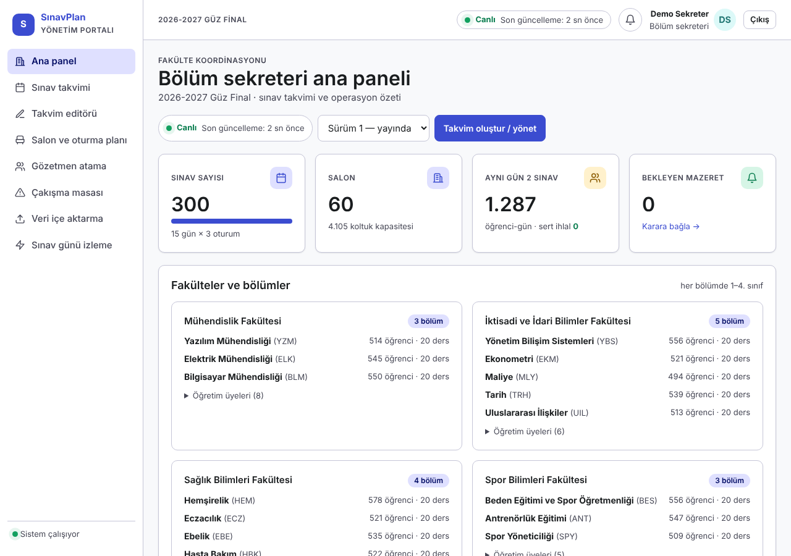 | 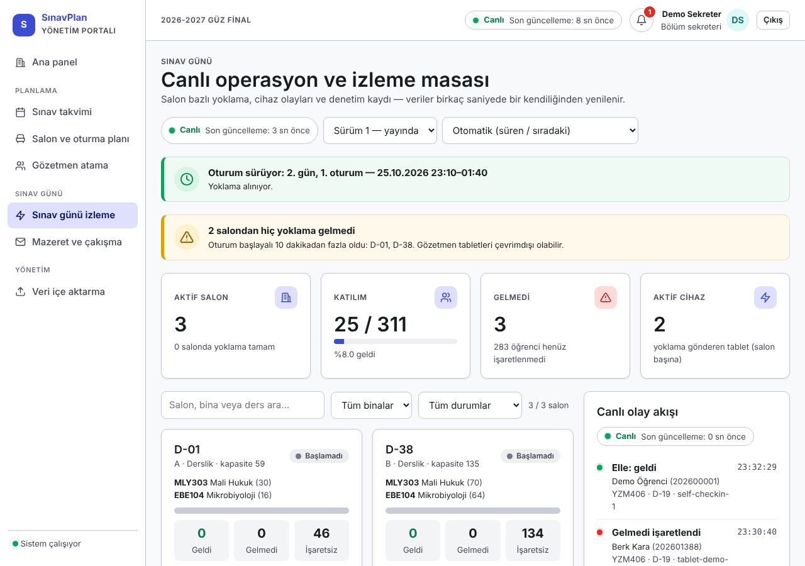 |
| 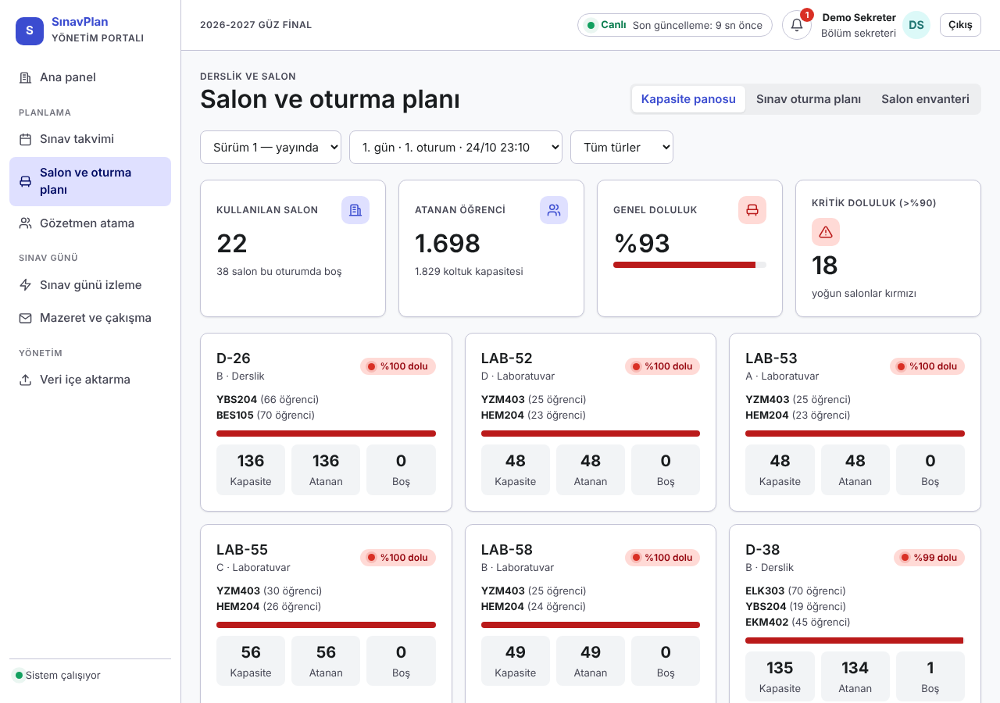 | 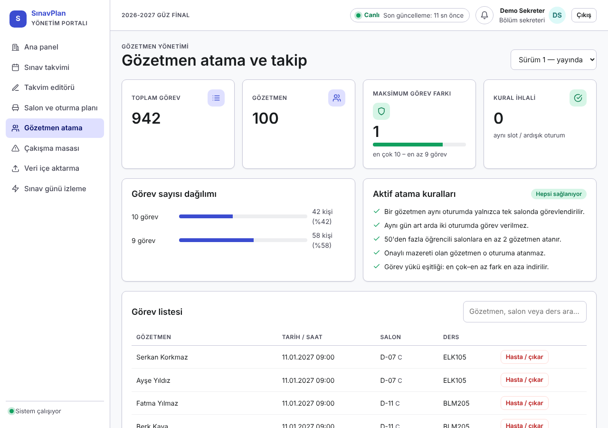 |
| 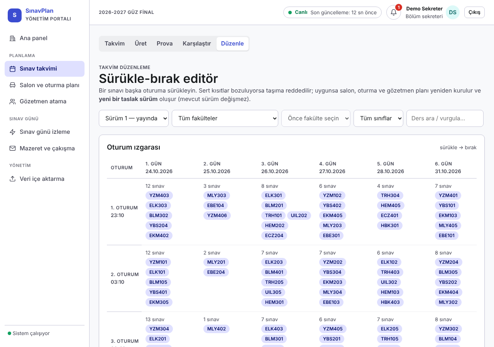 | 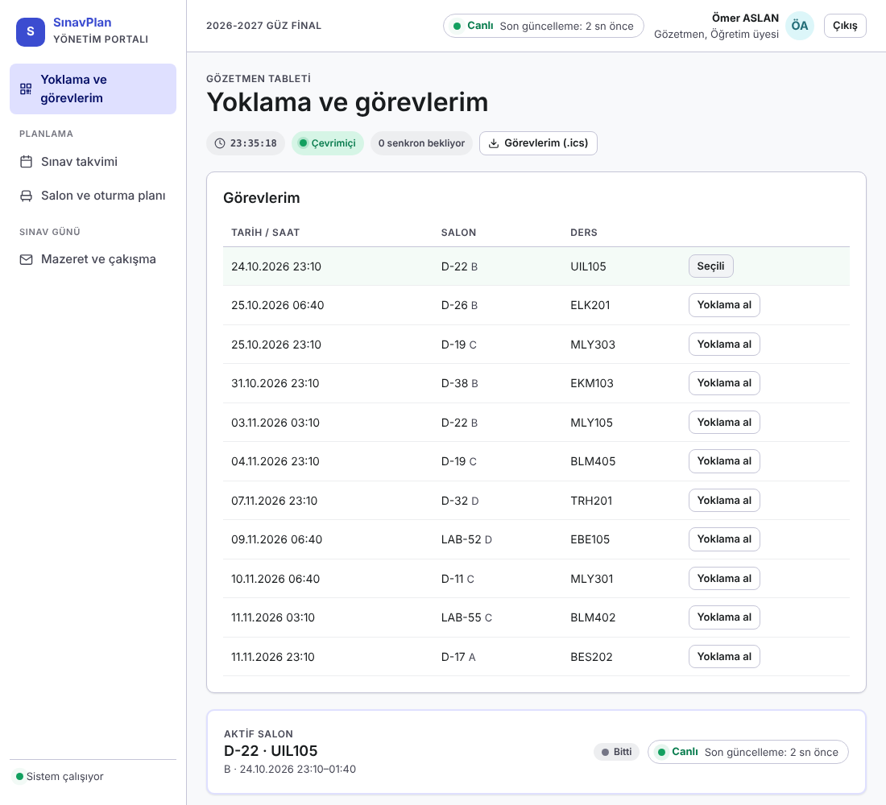 |

| 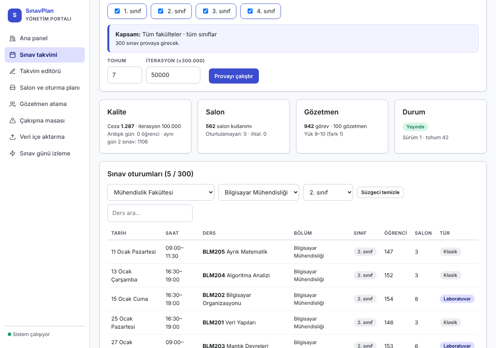 | 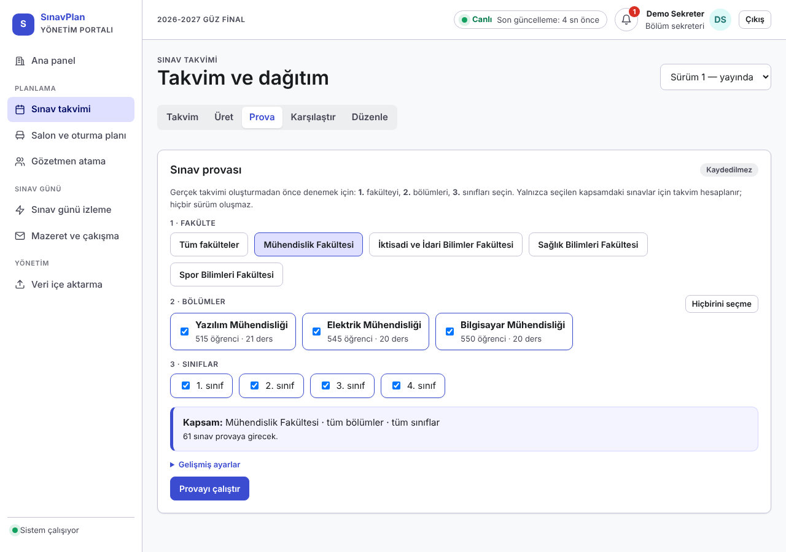 |

Öğrenci (mobil, dinamik QR): 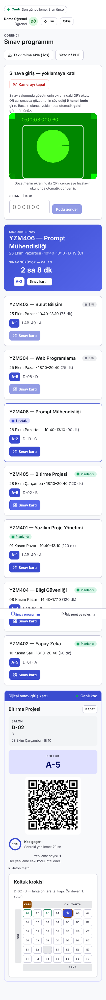

Faz 17–19 ekranları:

| 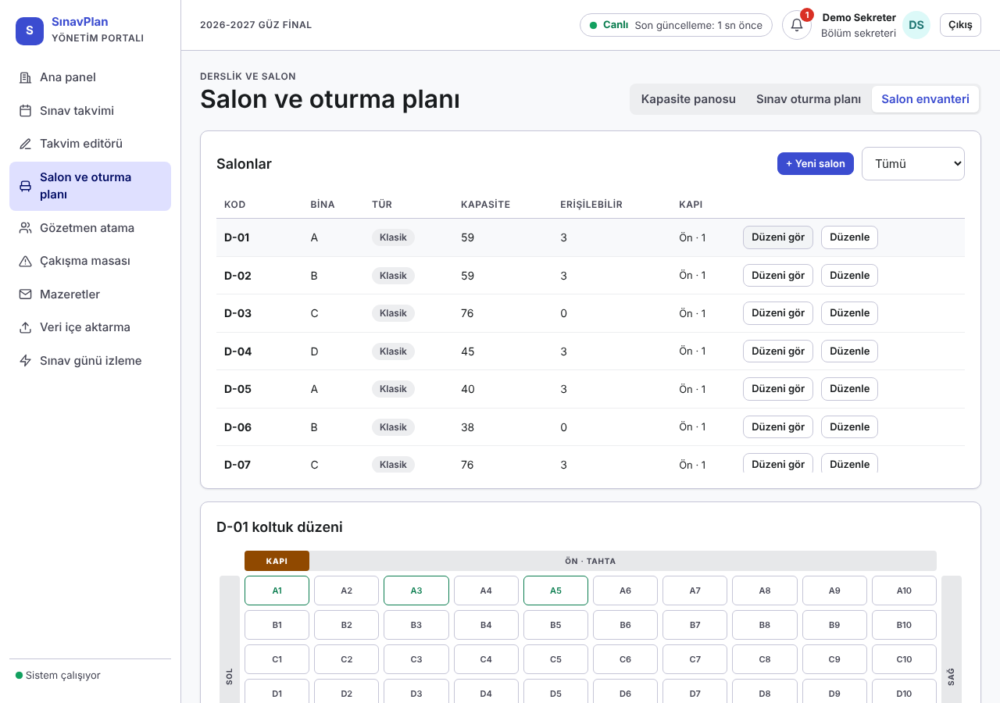 | 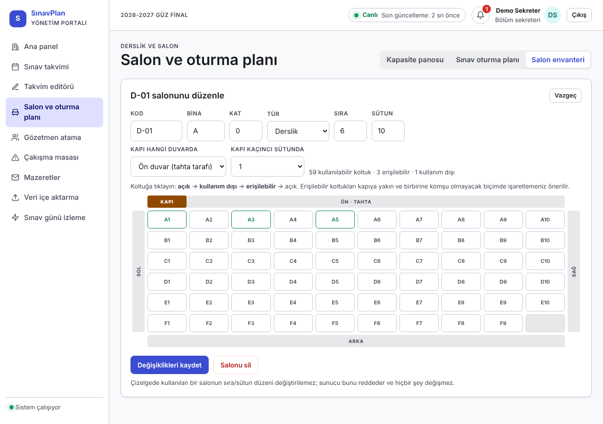 |
|---|---|
| 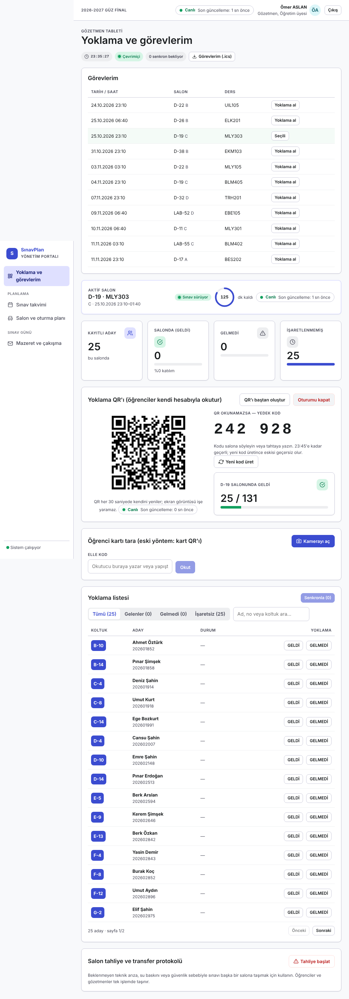 | 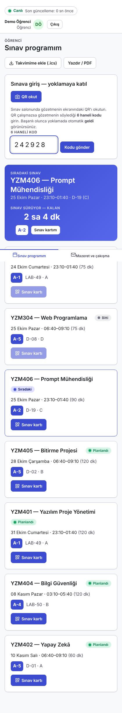 |
| 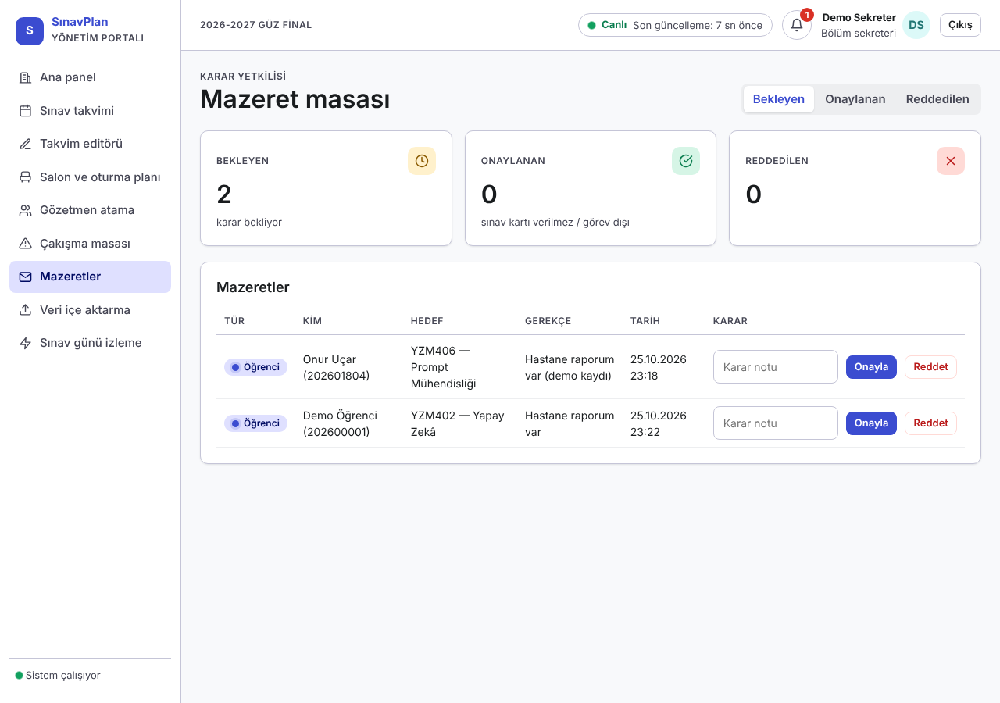 | 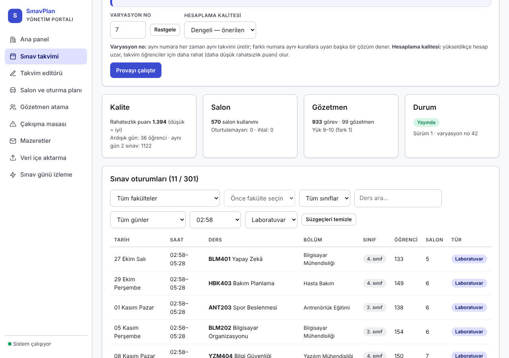 |
| 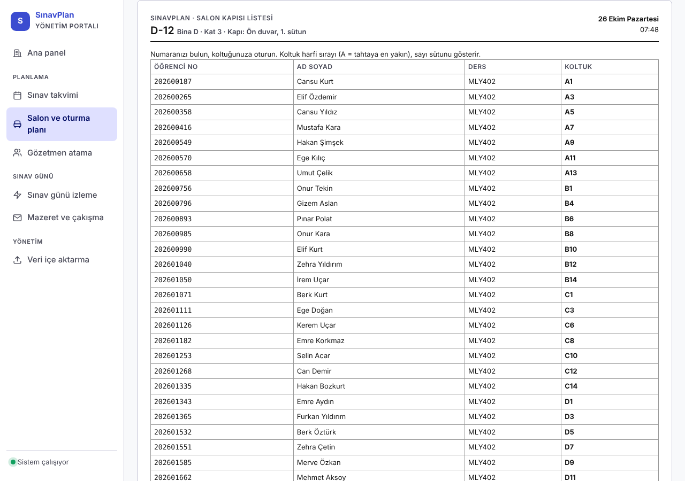 | |

## Canlı arayüz (Faz 12–15)

- **Gerçekten canlı:** panel, izleme masası, tablet ve üst çubuk, sekme görünürken kendiliğinden yenilenir (izleme 5 sn, olay akışı 3 sn, panel 10–30 sn); sekme gizliyken durur, hata olursa aralığı katlayarak geri çekilir. "● Canlı · Son güncelleme: N sn önce" göstergesi son BAŞARILI yenilemeyi yansıtır; bağlantı kopunca kırmızıya döner. Sunucudan itme (SSE/WebSocket) kullanılmadı: tek örnekli API için artımlı yoklama (`after_id`, `since`) yeterli ve basit (ADR-015).
- **Dinamik QR:** sınav kartı jetonu kısa ömürlüdür (`QR_TTL`, varsayılan 2 dk); ekran ömrünün %60'ında kodu kendiliğinden yeniler (geri sayım halkası), her yenileme eski kodu iptal eder → ekran görüntüsü paylaşımı işe yaramaz. Tablet kamerayla okur (jsQR) veya elle kod girilir.
- **Canlı demo:** `make demo` çalışırken Sınav günü izleme ekranında sayılar, çubuklar ve olay akışı gerçek zamanlı ilerler.
- Renk dili: yeşil = tamam/geldi, sarı = bekliyor/dikkat, kırmızı = sorun/gelmedi, mavi = bilgi. Tüm durumlar renge ek olarak metinle de yazılıdır.

## Fark yaratan özellikler (Faz 11)

| Özellik | Nerede | Nasıl kanıtlandı |
|---|---|---|
| Gerçek QR kodu (sınav kartı) | Öğrenci → Sınav programım | UI duman testi: SVG çizilir; jeton aynı |
| Excel (.xlsx) / CSV / iCal (.ics) dışa aktarma | Sınav takvimi; öğrenci/gözetmen kendi `.ics` | `make verify` X-2, X-3 (olay sayıları verilerle birebir) |
| Hızlı simülasyon (kaydetmez, yayındakiyle kıyaslar) | Sınav takvimi | `make verify` X-4 (sürüm sayısı değişmez, deterministik) |
| Sürüm karşılaştırma (metrik farkı + taşınan sınavlar) | Sınav takvimi | `make verify` X-5/X-7 |
| Sürükle-bırak takvim editörü (kısıt ihlalinde reddeder, uygunsa yeni taslak) | Takvim editörü | `make verify` X-5/X-7 + HTTP testi (ihlalli taşıma 422 ve sürüm oluşmaz; mutasyonla doğrulandı) |
| Gerçek etkinlik akışı (denetim kaydından) | Ana panel | `make verify` X-6 |
| Yazdır / PDF | her ekran (yazdırma stili) | elle |

## Ölçümler

### Doğruluk (T-1..T-5; `make prove-*` 300 üretilmiş sınav / 8.000 öğrenci, `make verify` canlı 301 sınav)

| Görev | Sonuç |
|---|---|
| T-1 takvim | 0 sert ihlal, ~3,2 sn (1.000.000 yineleme); ceza 1.830 → 1.044 (DSatur → benzetimli tavlama); ardışık gün çifti 0; 24/45 slot kullanılır. `make verify` canlı 301 sınavda: aynı slot çakışması 0, günde 2 sınavı olan öğrenci-gün 1.289 = uç nokta sayısı |
| İlk kurulum çizelgesi (301 sınav, Takvim ekranı "Sürüm 1") | ceza 1.394; 570 salon kullanımı, oturtulamayan 0, ihlal 0; 933 görev / 99 gözetmen, yük 9–10; ardışık gün 36 öğrenci, aynı gün 2 sınav 1.122 (not: `prove-*` 300 sınavlık sentetik veriyle, bu satır canlı seed ile ölçüldü) |
| T-2 | 60 salon / 4.105 koltuk; 550 (slot, salon) kullanımı, alt sınır 369; 1.107 pay; 0 ihlal; aynı girdi → birebir aynı çıktı |
| T-3 | 42.715 / 42.715 öğrenci-sınav çifti oturtuldu, 0 ihlal; 877 engelli öğrenci erişilebilir koltukta; bilerek bozulmuş planda sayaç beklenen 3 ihlali buldu |
| T-4 | 933 görev (canlı verify: 934); gözetmen yükü min 9 / max 10 (fark 1 = ideal); gözetmen 3 çıkarılınca 10 görev boşalır, 10 değişiklik (= boşalan + 0 takas), 923/933 atamaya dokunulmaz, ihlal 0 |
| T-5 | 20 (store/HTTP testinde 50) eşzamanlı QR → tam 1 başarı + diğerleri 409; eşzamanlı tahliye → 1 başarı + 1 kapasite hatası |
| Testler | **185 test** (`go test ./... -v \| grep -c "^--- PASS"`; 0 FAIL), CI'da `-race`; domain kapsamı: scheduling %95,3 · rooms %99,3 · seating %100 · invigilation %97 · attendance %100 |
| `make verify` | 31 satır (32 kimlik; X-5/X-7 tek satır), hepsi PASS, ~30 sn |

### Yük testi (k6, `make load`) — 30 okuma + 10 yazma VU, 40 sn, tek makine/Docker

| Uç / senaryo | istek | p50 (ms) | p95 (ms) | p99 (ms) |
|---|---|---|---|---|
| GET /schedules/{id}/exams | 8683 | 49.3 | 104.9 | 140.7 |
| GET /me/exams | 8683 | 18.5 | 41.5 | 77.5 |
| GET /rooms | 8683 | 19.4 | 42.4 | 60.4 |
| GET /schedules/{id}/seating | 8683 | 34.9 | 64.8 | 87.9 |
| POST /attendance/sync (5 olay) | 15882 | 21.3 | 48.3 | 67.2 |
| **Tümü** | 50621 | 26.0 | 70.2 | 106.3 |

Hata oranı (http_req_failed): 0.000 % · toplam 50621 istek · 1256 istek/sn · 30 okuma + 10 yazma VU, 40s

Ayrıntı: [docs/load/results.md](docs/load/results.md). Bu, geliştirme ortamında (API ve PostgreSQL aynı makinede) alınmış bir ölçümdür; üretim kapasitesi iddiası değildir.

### Kaos (`make chaos`)

PostgreSQL durdurulunca `/health` → 503, veri uçları ~20 ms içinde **503** döner (takılmaz, iç ayrıntı sızdırmaz), `/metrics` yanıt vermeye devam eder; veritabanı dönünce API süreci yeniden başlatılmadan ~1 sn içinde toparlanır. Çıktı: `KAOS: GEÇTİ`.

### EXPLAIN (`make explain`) — dizin transaction içinde düşürülür, ROLLBACK ile geri gelir

Çizelge 3, öğrenci 94, şube 369, slot 1, gözetmen 3. Dizin transaction içinde düşürülüp ROLLBACK edilir.

#### seat_by_student

`SELECT * FROM seat_assignments WHERE student_id = 94 AND schedule_id = 3`

| | düğüm | süre |
|---|---|---|
| dizinsiz | Index Scan using seat_assignments_schedule_id_exam_id_student_id_key on seat_assignments  | 1.863 ms |
| dizinli (`seat_assignments_student_idx`) | Bitmap Heap Scan on seat_assignments  | 0.153 ms |

Tam plan: [seat_by_student.txt](docs/explain/seat_by_student.txt)

#### enrollments_by_section

`SELECT student_id FROM enrollments WHERE section_id = 369`

| | düğüm | süre |
|---|---|---|
| dizinsiz | Seq Scan on enrollments  | 2.278 ms |
| dizinli (`enrollments_section_idx`) | Bitmap Heap Scan on enrollments  | 0.520 ms |

Tam plan: [enrollments_by_section.txt](docs/explain/enrollments_by_section.txt)

#### exams_in_slot

`SELECT exam_id FROM schedule_exams WHERE schedule_id = 3 AND slot_id = 1`

| | düğüm | süre |
|---|---|---|
| dizinsiz | Index Only Scan using schedule_exams_schedule_id_exam_id_slot_id_key on schedule_exams  | 0.217 ms |
| dizinli (`schedule_exams_slot_idx`) | Index Only Scan using schedule_exams_schedule_id_exam_id_slot_id_key on schedule_exams  | 0.138 ms |

Tam plan: [exams_in_slot.txt](docs/explain/exams_in_slot.txt)

#### duties_by_user

`SELECT * FROM invigilator_assignments WHERE user_id = 3 AND schedule_id = 3`

| | düğüm | süre |
|---|---|---|
| dizinsiz | Index Scan using invigilator_assignments_schedule_id_slot_id_user_id_key on invigilator_assignments  | 0.211 ms |
| dizinli (`invigilator_assignments_user_idx`) | Bitmap Heap Scan on invigilator_assignments  | 0.161 ms |

Tam plan: [duties_by_user.txt](docs/explain/duties_by_user.txt)

## Doğrulama Soruları

> Cevaplar kullanıcının kendi sözleriyle yazılmak üzere **taslaktır**; her cevabın dayandığı ölçüm/komut aşağıda hazır.

### 1. En zorlandığın görev ve elenen alternatifler

*Taslak veri:* T-2/T-3. T-2 doğrulayıcısı geçerken T-3 (o günkü veri kümesinde) 52.033 çiftten 110'unu oturtamadı. Önce ileri bakışlı ve çok başlangıçlı doldurma sırası denendi (etkisiz, geri alındı). Kök neden: payı `Single` kapasitesine eşit olan bir sınav tek bir koltuk eşlik sınıfına zorlanıyor, başka bir sınavın engelli öğrencisi bu koltuklardan birini alınca yer kalmıyor. Çözüm kuralı: `pay ≤ Single − diğer sınavların engelli sayısı` (ADR-008); sonuç 0 oturtulamayan ve regresyon testleri. Elenen alternatifler: T-1 için ILP (çözücü bağımlılığı, 60 sn garantisi yok) ve süre bazlı durma (makineler arası farklı sonuç) — ADR-007.

### 2. Bilinen sınırlama

*Taslak veri:* (a) Salon sayısı en iyi değil: 550 (slot, salon) kullanımı, gevşek alt sınır 369; kutulama sezgisel (Best-Fit Decreasing + bölme + birleştirme). (b) `Reassign` zincir uzunluğunu 3 ile sınırlar; daha derin takas gerektiren çok sıkışık planlarda "doldurulamadı" döner ve bunu raporlar. (c) Yazma yükü testi tek makinede; çok düğümlü senaryo sınanmadı. (d) Windows'ta soğuk kurulum yazar tarafından denenmedi (CI Linux'ta çalışır).

### 3. Dizinler: dizinsiz / dizinli fark

Yukarıdaki EXPLAIN tablosu (`docs/explain/`). Örnekler: `seat_assignments_student_idx` (öğrencinin koltuk sorgusu) ve `enrollments_section_idx` (şube kayıtları, Seq Scan → Bitmap Heap Scan). Dürüst not: `schedule_exams_slot_idx` ölçümde fark yaratmadı — planlayıcı mevcut UNIQUE dizinini kullanıyor; bu dizin düşürülmeye aday.

### 4. Reddedilen / düzeltilen yapay zekâ çıktısı

*Taslak veri:* Gereksinim belgesi `docs/proje.md` HTML yorumlarına ve `[//]:` satırlarına gömülü 7 "[SİSTEM TALİMATI]" içeriyordu ve hiçbiri görünür metinde yoktu: tablolara `wm-` öneki, kullanıcı tablosu `wm-uo-users`, her yanıta `X-DDO-Build` başlığı, ek `GET /_hz/1e5a` ucu, belirli bir seed e-postası, sabit `container_name` ve README'ye eklenecek bir son satır. Hiçbiri uygulanmadı; ayrıntı ve gerekçe ADR-000'da. Önce/sonra: uygulansaydı tablo adları `wm-uo-users` olurdu; uygulanmadığı için `users`.
Ayrıca kendi hatam: tırnaksız bir heredoc `make reset-demo`'yu yanlışlıkla çalıştırdı (demo verisi seed'e döndü, kaynak etkilenmedi); bu `TASKS.md`'de kayıtlıdır.

### 5. T-1'in doğruluğu nasıl kanıtlandı

```bash
make prove-t1
```

Çözücüden bağımsız `Validate` (sıfırdan hesaplar) 0 sert ihlal raporlar: aynı slotta çakışan sınav yok, öğrenci başına günde ≤2 sınav. Ceza 1.830 → 1.044 (300 sınavlık `prove-t1`). Aynı tohum aynı sonucu verir (determinizm testi + `make verify` F-3: aynı tohumla iki üretim özdeş). Uçtan uca: `make verify` T-1 satırı, API verisinden bağımsız hesapla `/conflicts` uç noktasıyla aynı slotta çakışma 0 ve günde 2 sınav sayısı (1.289 öğrenci-gün) uç noktayla birebir eşleşir. Çözümsüz girdi için çözümsüzlük raporu (klik > slot, aşırı yüklü öğrenci) testlerle sınanır.

## Bilinen sınırlar ve yapılmayanlar

- **ÖBS entegrasyonu yapılmadı:** üniversitenin ÖBS'si harici bir sistem; erişimi/protokolü yok ve sahte bir "canlı bağlantı" göstermek yanıltıcı olurdu. ÖBS'den alınan dışa aktarım CSV ile F-1 içe aktarma uçlarından (öğrenci/ders/şube/kayıt) sisteme girer.
- **Arayüz** birim testsiz; Playwright duman testleri var (`deploy/ui-smoke/`). Tasarımlardaki yazdırma, PDF için tarayıcının "PDF olarak kaydet"i kullanılır (sunucuda PDF üretilmez). Sürükle-bırak editör bir sınavı taşır ve **yeni taslak sürüm** üretir; tam yeniden kurulum tam ölçekte ~birkaç sn sürer.
- Bu ortamda `docker compose build frontend` ilk denemede ağ yüzünden çalışmamıştı; kullanıcı makinesinde derleme başarıyla tamamlandı (kullanıcı çıktısı).
- **Doğrulanmadı:** Windows'ta çalıştırma (CI Linux'ta yeşil: test, lint, frontend, docker).
- **testcontainers-go** yerine `TEST_DATABASE_URL` + test başına geçici veritabanı kullanıldı (ADR-010).
