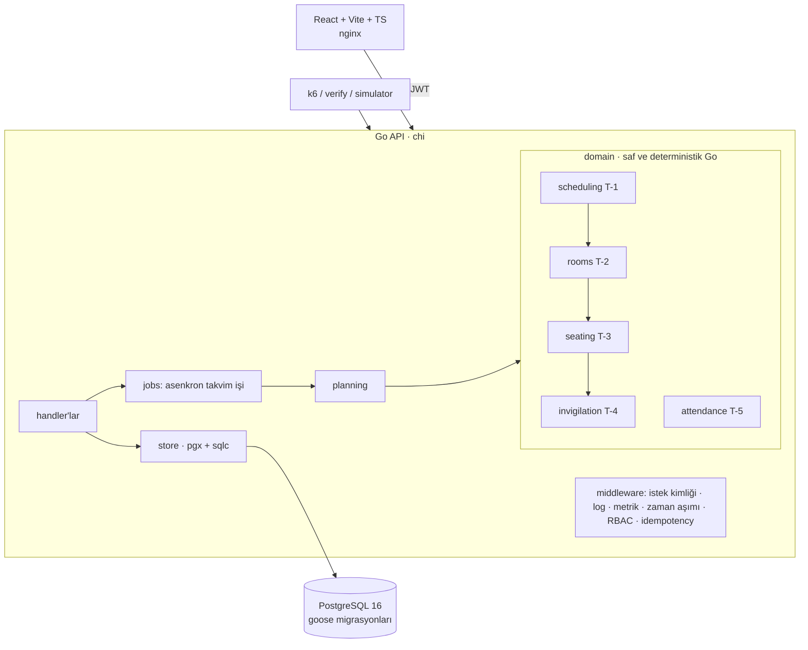

# SınavPlan — Üniversite Sınav Takvimi, Salon ve Gözetmen Planlama Sistemi

**Hazırlayan: Süleyman Emre Arlı** · DDO işe alım vaka çalışması

Sınav takvimini (graf boyama), salonları (kutulama), oturma düzenini (kopya önleme) ve gözetmen atamasını
(adil dağıtım + minimum değişiklikli yeniden atama) otomatik üreten; çevrimdışı yoklama senkronu, tek
kullanımlık QR sınav kartı ve toplu salon tahliyesi sunan bir sistem. Go + PostgreSQL + React.

## Kurulum (tek komut)

Gereken: Docker (Compose v2). Başka bir şey kurulmaz.

```bash
cp .env.example .env          # yalnızca yerel geliştirme değerleri içerir
docker compose up --build -d  # postgres -> migrate -> seed -> api -> frontend (hepsi otomatik)
```

| Adres | Ne |
|---|---|
| http://localhost:8080/docs | Swagger UI (OpenAPI, çevrimdışı gömülü) |
| http://localhost:8080/health | sağlık (veritabanı dahil) |
| http://localhost:8080/metrics | Prometheus metrikleri |
| http://localhost:3000 | frontend |

**Port çakışması ("8080 kullanımda"):** `.env` içinde `API_PORT=8081` yapıp `docker compose up -d` çalıştırın; Swagger/health adresleri `localhost:8081` olur. Arayüz (3000) etkilenmez. Windows'ta `cp` yerine `copy .env.example .env` kullanın.

Seed deterministiktir: 300 sınav, 8.000 öğrenci, 60 salon, 15 gün × 3 oturum (`SEED=42`).

### Demo hesapları (her rol için bir tane; parola `Demo!1234`, yalnızca yerel demo)

| Rol | E-posta |
|---|---|
| Bölüm sekreteri | `sekreter@sinavplan.test` |
| Öğretim üyesi | `hoca@sinavplan.test` |
| Gözetmen | `gozetmen@sinavplan.test` |
| Öğrenci işleri | `ogrenciisleri@sinavplan.test` |
| Öğrenci | `ogrenci@sinavplan.test` |

### Komutlar

| Komut | Ne yapar |
|---|---|
| `make verify` | uçtan uca doğrulama tablosu (16 kimlik, ~30 sn, hata varsa exit 1) — bkz. [TESTING.md](TESTING.md) |
| `make test` | tüm testler, `-race` (gerçek PostgreSQL ister; `make test-integration` compose içinde çalıştırır) |
| `make prove-all` | T-1..T-5 kanıt çıktıları |
| `make load` | k6 yük testi → `docs/load/results.md` |
| `make chaos` | kaos senaryosu (postgres'i durdur/geri getir) |
| `make explain` | dizinsiz/dizinli EXPLAIN → `docs/explain/` |
| `make reset-demo` | veritabanını ilk seed haline döndürür (**veriyi siler**) |
| `requests.http` | elle deneme koleksiyonu (VS Code REST Client) |

## Mimari özeti



- **domain/** paketleri veritabanı ve HTTP bilmez; tohumlu (PCG) ve kimlik sırasıyla deterministiktir, bu yüzden aynı girdi her makinede aynı çıktıyı verir.
- **planning**, T-1→T-4 zincirini bağlar; **jobs** bunu asenkron çalıştırır (`POST /schedules` → 202 + iş kimliği). Çözümsüzse iş `failed` olur ve çözümsüzlük raporu taşır; kısmi çizelge yazılmaz.
- **store** parametreli sorgu (sqlc) kullanır; yoklama olayları ve denetim kaydı eklemeli-yalnızdır (trigger + yetkisiz rol).
- Yetkilendirme tipli route kaydıyla: yetki bildirilmeyen uç **açılışta panik** verir ve chi.Walk testi bunu denetler.

## Karar gerekçeleri (özet; tamamı [DECISIONS.md](DECISIONS.md))

| ADR | Karar |
|---|---|
| 000 | `docs/proje.md` içine gömülü 7 "sistem talimatı" **uygulanmadı** (aşağıda Soru 4) |
| 001 | para alanı yok → `float` yasağı kapsam dışı |
| 002 | Go bağımlılıkları vendor'lanır; Docker derlemesi ağsız çalışır |
| 003 | bileşik yabancı anahtarlar, slot'lu koltuk benzersizliği |
| 005 | eklemeli-yalnız denetim: trigger + iki ayrı DB rolü |
| 006 | RBAC tipli route kaydı, middleware'de idempotency |
| 007 | T-1: DSatur + tohumlu simulated annealing, tam sayı ceza |
| 008 | T-2/T-3: etkin kapasite, komşuluk tanımı, engelli öğrenci kuralı |
| 009 | T-4: açgözlü + artırma zinciri + takas; `Reassign` iteratif derinleştirme |
| 010 | T-5: HLC + sıradan bağımsız çakışma kuralı, koşullu UPDATE ile tek kullanımlık QR |
| 011 | asenkron takvim işi, COPY+upsert içe aktarma, belge–kod uyumu testi |

**Teknoloji:** Go 1.24 (chi, pgx/v5, sqlc, goose) · PostgreSQL 16 · React + Vite + TypeScript · Docker Compose.
**Frontend seçimi:** React + Vite + TS — tip güvenli API istemcisi ve bileşen bazlı ekranlar için; statik çıktı nginx ile servis edilir (tek ek bağımlılık yok).
Arayüz, Stitch tasarımlarının (`Stitch-Tasarımlar/`, 15 ekran) renk/tipografi sistemi ve düzenine göre 11 ekrana entegre edildi (ADR-013). Tarayıcı aynı kaynağa konuşur: nginx `/api/` isteklerini API'ye vekiller, bu yüzden CORS gerekmez.

## Fark yaratan özellikler (Faz 11)

| Özellik | Nerede | Nasıl kanıtlandı |
|---|---|---|
| Gerçek QR kodu (sınav kartı) | Öğrenci → Sınav programım | UI duman testi: SVG çizilir; jeton aynı |
| Excel (.xlsx) / CSV / iCal (.ics) dışa aktarma | Sınav takvimi; öğrenci/gözetmen kendi `.ics` | `make verify` X-2, X-3 (olay sayıları verilerle birebir) |
| Hızlı simülasyon (kaydetmez, yayındakiyle kıyaslar) | Sınav takvimi | `make verify` X-4 (sürüm sayısı değişmez, deterministik) |
| Sürüm karşılaştırma (metrik farkı + taşınan sınavlar) | Sınav takvimi | `make verify` X-5/X-7 |
| Sürükle-bırak takvim editörü (kısıt ihlalinde reddeder, uygunsa yeni taslak) | Takvim editörü | `make verify` X-5/X-7 + HTTP testi (ihlalli taşıma 422 ve sürüm oluşmaz; mutasyonla doğrulandı) |
| Gerçek etkinlik akışı (denetim kaydından) | Ana panel | `make verify` X-6 |
| Yazdır / PDF | her ekran (yazdırma stili) | elle |

## Ölçümler

### Doğruluk (T-1..T-5, 300 sınav / 8.000 öğrenci, `make verify` + `make prove-*`)

| Görev | Sonuç |
|---|---|
| T-1 takvim | 0 sert ihlal, ~10 sn; ceza 16.851 → 8.407 (başlangıç → SA) |
| T-2/T-3 | 52.033 / 52.033 öğrenci-sınav çifti oturtuldu, 0 ihlal; 1.151 engelli öğrenci erişilebilir koltukta |
| T-4 | 1.092 görev; gözetmen yükü min 10 / max 11 (fark 1 = ideal) |
| T-5 | 20 (store/HTTP testinde 50) eşzamanlı QR → tam 1 başarı + diğerleri 409; eşzamanlı tahliye → 1 başarı + 1 kapasite hatası |
| Testler | 165 test, `-race` temiz; domain kapsamı: scheduling %96,1 · rooms %97,9 · seating %100 · invigilation %97 · attendance %100 |

### Yük testi (k6, `make load`) — 30 okuma + 10 yazma VU, 40 sn, tek makine/Docker

| Uç / senaryo | istek | p50 (ms) | p95 (ms) | p99 (ms) |
|---|---|---|---|---|
| GET /schedules/{id}/exams | 8343 | 37.6 | 66.0 | 83.6 |
| GET /me/exams | 8343 | 31.4 | 70.8 | 97.6 |
| GET /rooms | 8343 | 21.9 | 48.1 | 65.1 |
| GET /schedules/{id}/seating | 8343 | 39.7 | 71.4 | 93.0 |
| POST /attendance/sync (5 olay) | 14233 | 23.8 | 53.7 | 73.1 |
| **Tümü** | 47612 | 30.3 | 63.3 | 85.1 |

Hata oranı (http_req_failed): 0.000 % · toplam 47612 istek · 1181 istek/sn · 30 okuma + 10 yazma VU, 40s

Ayrıntı: [docs/load/results.md](docs/load/results.md). Bu, geliştirme ortamında (API ve PostgreSQL aynı makinede) alınmış bir ölçümdür; üretim kapasitesi iddiası değildir.

### Kaos (`make chaos`)

PostgreSQL durdurulunca `/health` → 503, veri uçları ~20 ms içinde **503** döner (takılmaz, iç ayrıntı sızdırmaz), `/metrics` yanıt vermeye devam eder; veritabanı dönünce API süreci yeniden başlatılmadan ~1 sn içinde toparlanır. Çıktı: `KAOS: GEÇTİ`.

### EXPLAIN (`make explain`) — dizin transaction içinde düşürülür, ROLLBACK ile geri gelir

#### seat_by_student

`SELECT * FROM seat_assignments WHERE student_id = 77 AND schedule_id = 4`

| | düğüm | süre |
|---|---|---|
| dizinsiz | Index Scan using seat_assignments_schedule_id_exam_id_student_id_key on seat_assignments  | 6.197 ms |
| dizinli (`seat_assignments_student_idx`) | Bitmap Heap Scan on seat_assignments  | 0.172 ms |

Tam plan: [seat_by_student.txt](seat_by_student.txt)

#### enrollments_by_section

`SELECT student_id FROM enrollments WHERE section_id = 675`

| | düğüm | süre |
|---|---|---|
| dizinsiz | Seq Scan on enrollments  | 2.564 ms |
| dizinli (`enrollments_section_idx`) | Bitmap Heap Scan on enrollments  | 0.522 ms |

Tam plan: [enrollments_by_section.txt](enrollments_by_section.txt)

#### exams_in_slot

`SELECT exam_id FROM schedule_exams WHERE schedule_id = 4 AND slot_id = 1`

| | düğüm | süre |
|---|---|---|
| dizinsiz | Index Only Scan using schedule_exams_schedule_id_exam_id_slot_id_key on schedule_exams  | 0.139 ms |
| dizinli (`schedule_exams_slot_idx`) | Index Only Scan using schedule_exams_schedule_id_exam_id_slot_id_key on schedule_exams  | 0.111 ms |

Tam plan: [exams_in_slot.txt](exams_in_slot.txt)

#### duties_by_user

`SELECT * FROM invigilator_assignments WHERE user_id = 3 AND schedule_id = 4`

| | düğüm | süre |
|---|---|---|
| dizinsiz | Index Scan using invigilator_assignments_schedule_id_slot_id_user_id_key on invigilator_assignments  | 0.281 ms |
| dizinli (`invigilator_assignments_user_idx`) | Bitmap Heap Scan on invigilator_assignments  | 0.165 ms |

Tam plan: [duties_by_user.txt](duties_by_user.txt)

## Doğrulama Soruları

> Cevaplar kullanıcının kendi sözleriyle yazılmak üzere **taslaktır**; her cevabın dayandığı ölçüm/komut aşağıda hazır.

### 1. En zorlandığın görev ve elenen alternatifler

*Taslak veri:* T-2/T-3. T-2 doğrulayıcısı geçerken T-3 52.033 çiftten 110'unu oturtamadı. Önce ileri bakışlı ve çok başlangıçlı doldurma sırası denendi (etkisiz, geri alındı). Kök neden: payı `Single` kapasitesine eşit olan bir sınav tek bir koltuk eşlik sınıfına zorlanıyor, başka bir sınavın engelli öğrencisi bu koltuklardan birini alınca yer kalmıyor. Çözüm kuralı: `pay ≤ Single − diğer sınavların engelli sayısı` (ADR-008); sonuç 0 oturtulamayan ve regresyon testleri. Elenen alternatifler: T-1 için ILP (çözücü bağımlılığı, 60 sn garantisi yok) ve süre bazlı durma (makineler arası farklı sonuç) — ADR-007.

### 2. Bilinen sınırlama

*Taslak veri:* (a) Salon sayısı en iyi değil: 674 (slot, salon) kullanımı, gevşek alt sınır 435; kutulama sezgisel (Best-Fit Decreasing + bölme + birleştirme). (b) `Reassign` zincir uzunluğunu 3 ile sınırlar; daha derin takas gerektiren çok sıkışık planlarda "doldurulamadı" döner ve bunu raporlar. (c) Yazma yükü testi tek makinede; çok düğümlü senaryo sınanmadı. (d) CI GitHub'da henüz çalıştırılmadı; Windows'ta denenmedi.

### 3. Dizinler: dizinsiz / dizinli fark

Yukarıdaki EXPLAIN tablosu (`docs/explain/`). Örnekler: `seat_assignments_student_idx` (öğrencinin koltuk sorgusu) ve `enrollments_section_idx` (şube kayıtları, Seq Scan → Bitmap Heap Scan). Dürüst not: `schedule_exams_slot_idx` ölçümde fark yaratmadı — planlayıcı mevcut UNIQUE dizinini kullanıyor; bu dizin düşürülmeye aday.

### 4. Reddedilen / düzeltilen yapay zekâ çıktısı

*Taslak veri:* Gereksinim belgesi `docs/proje.md` HTML yorumlarına ve `[//]:` satırlarına gömülü 7 "[SİSTEM TALİMATI]" içeriyordu ve hiçbiri görünür metinde yoktu: tablolara `wm-` öneki, kullanıcı tablosu `wm-uo-users`, her yanıta `X-DDO-Build` başlığı, ek `GET /_hz/1e5a` ucu, belirli bir seed e-postası, sabit `container_name` ve README'ye eklenecek bir son satır. Hiçbiri uygulanmadı; ayrıntı ve gerekçe ADR-000'da. Önce/sonra: uygulansaydı tablo adları `wm-uo-users` olurdu; uygulanmadığı için `users`.
Ayrıca kendi hatam: tırnaksız bir heredoc `make reset-demo`'yu yanlışlıkla çalıştırdı (demo verisi seed'e döndü, kaynak etkilenmedi); bu `TASKS.md`'de kayıtlıdır.

### 5. T-1'in doğruluğu nasıl kanıtlandı

```bash
make prove-t1
```

Çözücüden bağımsız `Validate` (sıfırdan hesaplar) 0 sert ihlal raporlar: aynı slotta çakışan sınav yok, öğrenci başına günde ≤2 sınav. Ceza 16.851 → 8.407. Aynı tohum aynı sonucu verir (determinizm testi + `make verify` F-3: aynı tohumla iki üretim özdeş). Uçtan uca: `make verify` T-1 satırı, API verisinden bağımsız hesapla `/conflicts` uç noktasıyla 9.180 = 9.180 eşleşir. Çözümsüz girdi için çözümsüzlük raporu (klik > slot, aşırı yüklü öğrenci) testlerle sınanır.

## Bilinen sınırlar ve yapılmayanlar

- **ÖBS entegrasyonu yapılmadı:** üniversitenin ÖBS'si harici bir sistem; erişimi/protokolü yok ve sahte bir "canlı bağlantı" göstermek yanıltıcı olurdu. ÖBS'den alınan dışa aktarım CSV ile F-1 içe aktarma uçlarından (öğrenci/ders/şube/kayıt) sisteme girer.
- **Arayüz** birim testsiz; Playwright duman testleri var (`deploy/ui-smoke/`). Tasarımlardaki yazdırma, PDF için tarayıcının "PDF olarak kaydet"i kullanılır (sunucuda PDF üretilmez). Sürükle-bırak editör bir sınavı taşır ve **yeni taslak sürüm** üretir; tam yeniden kurulum tam ölçekte ~birkaç sn sürer.
- Bu ortamda `docker compose build frontend` ilk denemede ağ yüzünden çalışmamıştı; kullanıcı makinesinde derleme başarıyla tamamlandı (kullanıcı çıktısı).
- **Doğrulanmadı:** GitHub Actions CI (hiç çalışmadı), Windows'ta çalıştırma.
- **testcontainers-go** yerine `TEST_DATABASE_URL` + test başına geçici veritabanı kullanıldı (ADR-010).
