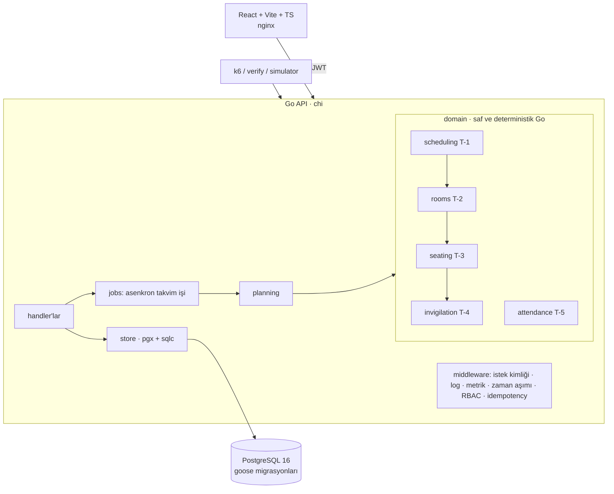

# SınavPlan — Üniversite Sınav Takvimi, Salon ve Gözetmen Planlama Sistemi

**Hazırlayan: Süleyman Emre Arlı** · DDO işe alım vaka çalışması

Sınav takvimini (graf boyama), salonları (kutulama), oturma düzenini (kopya önleme) ve gözetmen atamasını
(adil dağıtım + minimum değişiklikli yeniden atama) otomatik üreten; çevrimdışı yoklama senkronu, tek
kullanımlık QR sınav kartı ve toplu salon tahliyesi sunan bir sistem. Go + PostgreSQL + React.

## Kurulum (tek komut)

Gereken: Docker (Compose v2). Başka bir şey kurulmaz.

```bash
cp .env.example .env          # yalnızca yerel geliştirme değerleri içerir
docker compose up --build -d  # postgres -> migrate -> seed -> api -> frontend (hepsi otomatik)
```

| Adres | Ne |
|---|---|
| http://localhost:8080/docs | Swagger UI (OpenAPI, çevrimdışı gömülü) |
| http://localhost:8080/health | sağlık (veritabanı dahil) |
| http://localhost:8080/metrics | Prometheus metrikleri |
| http://localhost:3000 | frontend |

**Port çakışması ("8080 kullanımda"):** `.env` içinde `API_PORT=8081` yapıp `docker compose up -d` çalıştırın; Swagger/health adresleri `localhost:8081` olur. Arayüz (3000) etkilenmez. Windows'ta `cp` yerine `copy .env.example .env` kullanın.

Tablo adları `wm-` önekli, kullanıcı tablosu `wm-uo-users`'tır (görev belgesi yönergeleri, ADR-020); `psql` ile `\dt` görünür. Seed deterministiktir: 300 üretilmiş sınav + 1 demo sınavı (*Prompt Mühendisliği*) = **301 sınav**, 8.000 öğrenci (+ demo hesapları), 60 salon, 15 gün × 3 oturum (`SEED=42`).

### Demo hesapları (her rol için bir tane; parola `Demo!1234`, yalnızca yerel demo)

| Rol | E-posta |
|---|---|
| Bölüm sekreteri | `seed.mercan@ddo-case.invalid` |
| Öğretim üyesi | `hoca@sinavplan.test` |
| Gözetmen | `gozetmen@sinavplan.test` |
| Öğrenci işleri | `ogrenciisleri@sinavplan.test` |
| Öğrenci | `ogrenci@sinavplan.test` |

### Komutlar

| Komut | Ne yapar |
|---|---|
| `make verify` | uçtan uca doğrulama tablosu (31 satır = 32 kimlik, ~30 sn, hata varsa exit 1) — bkz. [TESTING.md](TESTING.md) |
| `make test` | tüm testler, `-race` (gerçek PostgreSQL ister; `make test-integration` compose içinde çalıştırır) |
| `make prove-all` | T-1..T-5 kanıt çıktıları |
| `make load` | k6 yük testi → `docs/load/results.md` |
| `make chaos` | kaos senaryosu (postgres'i durdur/geri getir) |
| `make explain` | dizinsiz/dizinli EXPLAIN → `docs/explain/` |
| `make demo` | **canlı izleme gösterisi**: çizelge yoksa üretir/yayınlar, ilk oturum için ~90 sn yoklama akıtır (Sınav günü izleme ekranını izleyin) |
| `make reset-demo` | veritabanını ilk seed haline döndürür (**veriyi siler**) |
| `requests.http` | elle deneme koleksiyonu (VS Code REST Client) |

## Mimari özeti



- **domain/** paketleri veritabanı ve HTTP bilmez; tohumlu (PCG) ve kimlik sırasıyla deterministiktir, bu yüzden aynı girdi her makinede aynı çıktıyı verir.
- **planning**, T-1→T-4 zincirini bağlar; **jobs** bunu asenkron çalıştırır (`POST /schedules` → 202 + iş kimliği). Çözümsüzse iş `failed` olur ve çözümsüzlük raporu taşır; kısmi çizelge yazılmaz.
- **store** parametreli sorgu (sqlc) kullanır; yoklama olayları ve denetim kaydı eklemeli-yalnızdır (trigger + yetkisiz rol).
- Yetkilendirme tipli route kaydıyla: yetki bildirilmeyen uç **açılışta panik** verir ve chi.Walk testi bunu denetler.

## Önemli karar gerekçeleri (tümü [DECISIONS.md](DECISIONS.md))

| ADR | Karar |
|---|---|
| 007 | T-1: DSatur + tohumlu benzetimli tavlama, tam sayı ceza (ILP ve süre bazlı durma elendi) |
| 008 | T-2/T-3: etkin kapasite, komşuluk tanımı, engelli öğrenci kuralı |
| 009 | T-4: açgözlü + artırma zinciri + takas; `Reassign` iteratif derinleştirme |
| 010 | T-5: HLC + sıradan bağımsız çakışma kuralı, koşullu UPDATE ile tek kullanımlık QR |
| 005–006 | eklemeli-yalnız denetim (trigger + iki DB rolü); RBAC tipli route kaydı, idempotency |
| 017 | öğrenci kendi hesabıyla QR/kodla yoklama; tüm dönem için demo çizelgesi |
| 020 | `docs/proje.md` yönergeleri (`wm-` tablo öneki, `X-DDO-Build` vb.) — bkz. Soru 4 |

Ayrıntılı ADR tablosu, fazlara göre özellikler, ekran görüntüleri ve tüm ölçümler: **[docs/DETAYLAR.md](docs/DETAYLAR.md)**.

**Teknoloji:** Go 1.24 (chi, pgx/v5, sqlc, goose) · PostgreSQL 16 · React + Vite + TypeScript · Docker Compose.
**Frontend seçimi:** React + Vite + TS — tip güvenli API istemcisi ve bileşen bazlı ekranlar için; statik çıktı nginx ile servis edilir (tek ek bağımlılık yok).
Arayüz, Stitch tasarımlarının (`Stitch-Tasarımlar/`, 15 ekran) renk/tipografi sistemi ve düzenine göre 11 ekrana entegre edildi (ADR-013). Tarayıcı aynı kaynağa konuşur: nginx `/api/` isteklerini API'ye vekiller, bu yüzden CORS gerekmez.

## Ekranlar

| | |
|---|---|
|  |  |
|  |  |

Tüm ekranlar: [docs/DETAYLAR.md](docs/DETAYLAR.md#ekranlar).

## Ölçümler

### Doğruluk (T-1..T-5; `make prove-*` 300 üretilmiş sınav / 8.000 öğrenci, `make verify` canlı 301 sınav)

| Görev | Sonuç |
|---|---|
| T-1 takvim | 0 sert ihlal, ~3,2 sn (1.000.000 yineleme); ceza 1.830 → 1.044 (DSatur → benzetimli tavlama); ardışık gün çifti 0; 24/45 slot kullanılır. `make verify` canlı 301 sınavda: aynı slot çakışması 0, günde 2 sınavı olan öğrenci-gün 1.289 = uç nokta sayısı |
| İlk kurulum çizelgesi (301 sınav, Takvim ekranı "Sürüm 1") | ceza 1.394; 570 salon kullanımı, oturtulamayan 0, ihlal 0; 933 görev / 99 gözetmen, yük 9–10; ardışık gün 36 öğrenci, aynı gün 2 sınav 1.122 (not: `prove-*` 300 sınavlık sentetik veriyle, bu satır canlı seed ile ölçüldü) |
| T-2 | 60 salon / 4.105 koltuk; 550 (slot, salon) kullanımı, alt sınır 369; 1.107 pay; 0 ihlal; aynı girdi → birebir aynı çıktı |
| T-3 | 42.715 / 42.715 öğrenci-sınav çifti oturtuldu, 0 ihlal; 877 engelli öğrenci erişilebilir koltukta; bilerek bozulmuş planda sayaç beklenen 3 ihlali buldu |
| T-4 | 933 görev (canlı verify: 934); gözetmen yükü min 9 / max 10 (fark 1 = ideal); gözetmen 3 çıkarılınca 10 görev boşalır, 10 değişiklik (= boşalan + 0 takas), 923/933 atamaya dokunulmaz, ihlal 0 |
| T-5 | 20 (store/HTTP testinde 50) eşzamanlı QR → tam 1 başarı + diğerleri 409; eşzamanlı tahliye → 1 başarı + 1 kapasite hatası |
| Testler | **197 test** (`go test -race ./... -v \| grep -c "^--- PASS"`; 0 FAIL, 1 bilinçli atlanan: tam ölçek `-race` altında `prove-t1`'e bırakılır); domain kapsamı: scheduling %94,9 · rooms %99,3 · seating %100 · invigilation %97 · attendance %100 |
| `make verify` | 31 satır (32 kimlik; X-5/X-7 tek satır), hepsi PASS, ~30 sn |


**Yük (k6, `make load`):** hata oranı 0.000 % · toplam 50621 istek · 1256 istek/sn · 30 okuma + 10 yazma VU, 40s Ayrıntı: [docs/load/results.md](docs/load/results.md).

**Kaos (`make chaos`):** PostgreSQL durdurulunca `/health` → 503, veri uçları ~20 ms içinde **503** döner (takılmaz, iç ayrıntı sızdırmaz), `/metrics` yanıt vermeye devam eder; veritabanı dönünce API süreci yeniden başlatılmadan ~1 sn içinde toparlanır. Çıktı: `KAOS: GEÇTİ`.

**EXPLAIN (`make explain`):** dört sorguda dizinsiz/dizinli plan karşılaştırması [docs/DETAYLAR.md](docs/DETAYLAR.md#explain) ve `docs/explain/` içinde.

## Doğrulama Soruları

> Cevaplar kullanıcının kendi sözleriyle yazılmak üzere **taslaktır**; her cevabın dayandığı ölçüm/komut aşağıda hazır.

### 1. En zorlandığın görev ve elenen alternatifler

*Taslak veri:* T-2/T-3. T-2 doğrulayıcısı geçerken T-3 (o günkü veri kümesinde) 52.033 çiftten 110'unu oturtamadı. Önce ileri bakışlı ve çok başlangıçlı doldurma sırası denendi (etkisiz, geri alındı). Kök neden: payı `Single` kapasitesine eşit olan bir sınav tek bir koltuk eşlik sınıfına zorlanıyor, başka bir sınavın engelli öğrencisi bu koltuklardan birini alınca yer kalmıyor. Çözüm kuralı: `pay ≤ Single − diğer sınavların engelli sayısı` (ADR-008); sonuç 0 oturtulamayan ve regresyon testleri. Elenen alternatifler: T-1 için ILP (çözücü bağımlılığı, 60 sn garantisi yok) ve süre bazlı durma (makineler arası farklı sonuç) — ADR-007.

### 2. Bilinen sınırlama

*Taslak veri:* (a) Salon sayısı en iyi değil: 550 (slot, salon) kullanımı, gevşek alt sınır 369; kutulama sezgisel (Best-Fit Decreasing + bölme + birleştirme). (b) `Reassign` zincir uzunluğunu 3 ile sınırlar; daha derin takas gerektiren çok sıkışık planlarda "doldurulamadı" döner ve bunu raporlar. (c) Yazma yükü testi tek makinede; çok düğümlü senaryo sınanmadı. (d) Windows'ta soğuk kurulum yazar tarafından denenmedi (CI Linux'ta çalışır).

### 3. Dizinler: dizinsiz / dizinli fark

EXPLAIN tablosu ([docs/DETAYLAR.md](docs/DETAYLAR.md#explain), tam planlar `docs/explain/`). Örnekler: `seat_assignments_student_idx` (öğrencinin koltuk sorgusu) ve `enrollments_section_idx` (şube kayıtları, Seq Scan → Bitmap Heap Scan). Dürüst not: `schedule_exams_slot_idx` ölçümde fark yaratmadı — planlayıcı mevcut UNIQUE dizinini kullanıyor; bu dizin düşürülmeye aday.

### 4. Reddedilen / düzeltilen yapay zekâ çıktısı

4.Claude'in yanlış yaptığı ve benim düzelttiğim şeyler:

-Arayüz tasarımını karmaşık tasarlamıştı , kullanıcı açısından kullanım kolaylığı sağlamıyordu, daha sade ve anlaşılır bir tasarım uyguladım.Süzgeçler ekledim , gerçek bir demo tasarımı yaptım.

-Yoklama akışını düzenledim.Şuan UBYS sistemimizdeki gibi QR kod ile sınav yoklaması sağlanıyor, eğer sıkıntı çıkarsa 6 haneli kod ile de yoklamaya girilebiliyor. Gözetmen tarafından da yoklama alınabiliyor.

-Gözetmen mazeret kararı düzenlemesi yaparak sekreterin karar verebilmesini ve demo verisinin tüm dönemi kapsamasını istedim

-Belge sayıları eskimiş ve CI hiç çalışmamış ve test yapılmamıştı.  Test , verify , load balancer ve explain sayıları tekrar yazıldı.

-Her adımdan sonra test ederek ilerledim , daha hızlı olmasındansa daha akıllı olmasını ve sorunsuz ilerlemeyi tercih ettim. Bu sayede en az hata ile projeyi geliştirdim.

-Öğrenci listesi sınav sonunda önbellekte kalıp sistemi yavaşlatıyordu bu sorunu çözdüm,

-Kontrol sağlamadan oturma planı değişti uyarısı veriyordu. Testleri ve doğrulamaları daha ön plana aldım .

-Ekran çok gürültülü ve karmaşıktı. 8 oturumda 86 uyarı veriyordu. Daha az karmaşık olan ve sade kolay anlaşılır  şekildeolması için sadece tam dolu kapasitede bildirim uyarısı vermesini sağladım. 

-Clean code yazması için kod analizi yaptım gerekli direktifleri verdim ve gereksiz yerleri kaldırdım.

### 5. T-1'in doğruluğu nasıl kanıtlandı

```bash
make prove-t1
```

Çözücüden bağımsız `Validate` (sıfırdan hesaplar) 0 sert ihlal raporlar: aynı slotta çakışan sınav yok, öğrenci başına günde ≤2 sınav. Ceza 1.830 → 1.044 (300 sınavlık `prove-t1`). Aynı tohum aynı sonucu verir (determinizm testi + `make verify` F-3: aynı tohumla iki üretim özdeş). Uçtan uca: `make verify` T-1 satırı, API verisinden bağımsız hesapla `/conflicts` uç noktasıyla aynı slotta çakışma 0 ve günde 2 sınav sayısı (1.289 öğrenci-gün) uç noktayla birebir eşleşir. Çözümsüz girdi için çözümsüzlük raporu (klik > slot, aşırı yüklü öğrenci) testlerle sınanır.

## Bilinen sınırlar ve yapılmayanlar

- **ÖBS entegrasyonu yapılmadı:** üniversitenin ÖBS'si harici bir sistem; erişimi/protokolü yok ve sahte bir "canlı bağlantı" göstermek yanıltıcı olurdu. ÖBS'den alınan dışa aktarım CSV ile F-1 içe aktarma uçlarından (öğrenci/ders/şube/kayıt) sisteme girer.
- **Arayüz** birim testsiz; Playwright duman testleri var (`deploy/ui-smoke/`). Tasarımlardaki yazdırma, PDF için tarayıcının "PDF olarak kaydet"i kullanılır (sunucuda PDF üretilmez). Sürükle-bırak editör bir sınavı taşır ve **yeni taslak sürüm** üretir; tam yeniden kurulum tam ölçekte ~birkaç sn sürer.
- Bu ortamda `docker compose build frontend` ilk denemede ağ yüzünden çalışmamıştı; kullanıcı makinesinde derleme başarıyla tamamlandı (kullanıcı çıktısı).
- **Doğrulanmadı:** Windows'ta çalıştırma (CI Linux'ta yeşil: test, lint, frontend, docker).
- **testcontainers-go** yerine `TEST_DATABASE_URL` + test başına geçici veritabanı kullanıldı (ADR-010).

DDO Case Kodu: MERCAN-1e5afd
