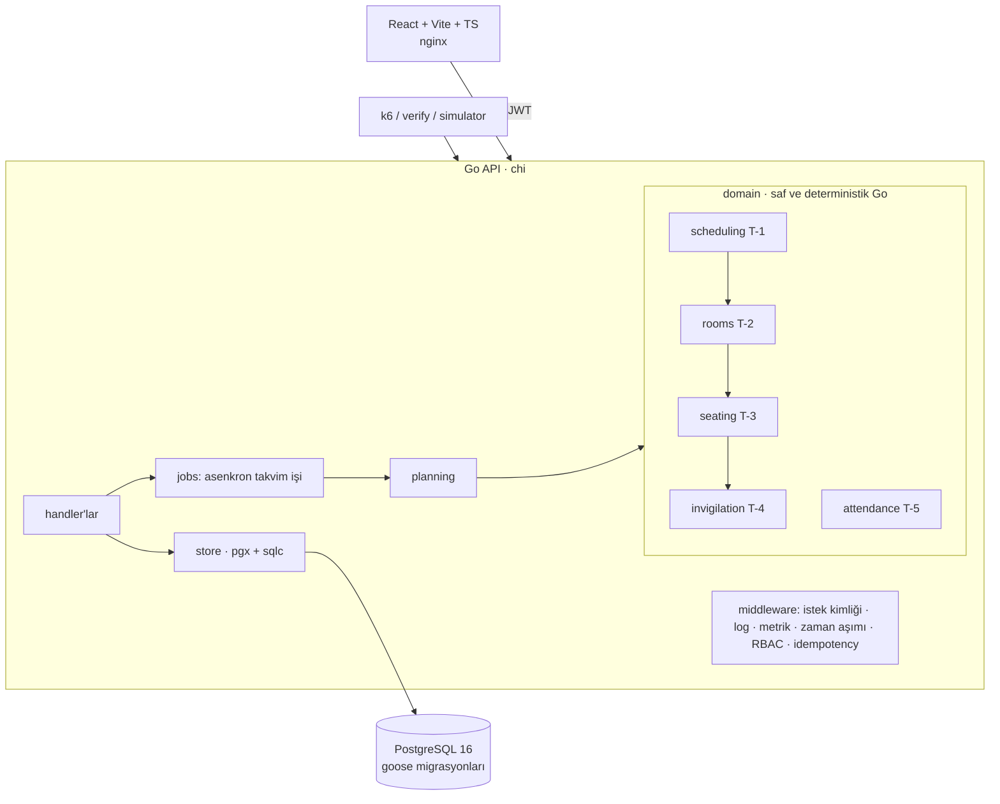
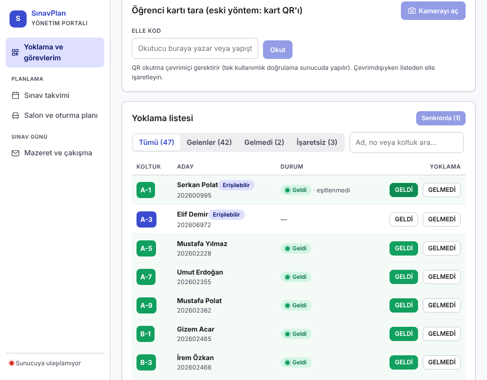

# SınavPlan — Üniversite Sınav Takvimi, Salon ve Gözetmen Planlama Sistemi

**Hazırlayan: Süleyman Emre Arlı** · DDO işe alım vaka çalışması

Sınav takvimini (graf boyama), salonları (kutulama), oturma düzenini (kopya önleme) ve gözetmen atamasını
(adil dağıtım + minimum değişiklikli yeniden atama) otomatik üreten; çevrimdışı yoklama senkronu, tek
kullanımlık QR sınav kartı ve toplu salon tahliyesi sunan bir sistem. Go + PostgreSQL + React.

## Kurulum (tek komut)

Gereken: Docker (Compose v2). Başka bir şey kurulmaz.

```bash
cp .env.example .env          # yalnızca yerel geliştirme değerleri içerir
docker compose up --build -d  # postgres -> migrate -> seed -> api -> frontend (hepsi otomatik)
```

| Adres | Ne |
|---|---|
| http://localhost:8080/docs | Swagger UI (OpenAPI, çevrimdışı gömülü) |
| http://localhost:8080/health | sağlık (veritabanı dahil) |
| http://localhost:8080/metrics | Prometheus metrikleri |
| http://localhost:3000 | frontend |

**Port çakışması ("8080 kullanımda"):** `.env` içinde `API_PORT=8081` yapıp `docker compose up -d` çalıştırın; Swagger/health adresleri `localhost:8081` olur. Arayüz (3000) etkilenmez. Windows'ta `cp` yerine `copy .env.example .env` kullanın.

Tablo adları `wm-` önekli, kullanıcı tablosu `wm-uo-users`'tır (görev belgesi yönergeleri, ADR-020); `psql` ile `\dt` görünür. Seed deterministiktir: 300 üretilmiş sınav + 1 demo sınavı (*Prompt Mühendisliği*) = **301 sınav**, 8.000 öğrenci (+ demo hesapları), 60 salon, 15 gün × 3 oturum (`SEED=42`).

### Demo hesapları (her rol için bir tane; parola `Demo!1234`, yalnızca yerel demo)

| Rol | E-posta |
|---|---|
| Bölüm sekreteri | `seed.mercan@ddo-case.invalid` |
| Öğretim üyesi | `hoca@sinavplan.test` |
| Gözetmen | `gozetmen@sinavplan.test` |
| Öğrenci işleri | `ogrenciisleri@sinavplan.test` |
| Öğrenci | `ogrenci@sinavplan.test` |

**Demo yoklama kodu: `111111`** — öğrenci hesabıyla "Sınava giriş" ekranında bu kodu girince, gözetmen olmadan, yayındaki çizelgede o an en yakın sınavı için yoklamada *geldi* yazılır (ekranda da yayınlanır). `DEMO_CHECKIN_CODE` ile değişir; boş bırakılırsa kapanır (bkz. ADR-021). Gözetmen ekranında "Kod üret" yalnız 6 haneli kod üretir; sekreterin ana panelinde ve Gözetmen atama ekranında "Gözetmen programı" (kim, hangi salon, ne zaman) listelenir. **Bildirim kutusu** (üst çubuk, her rol): sınav/görev hatırlatması, "yoklamanız alınmadı" (başladıktan 15 dk sonra), mazeret kararı, gözetmen devri, salon değişikliği. **Krokiden yoklama:** Kapasite panosunda ders koduna tıklayınca salon krokisi + öğrenci listesi açılır; gözetmen/sekreter koltuğa tıklayıp geldi/gelmedi işaretler (ağ yoksa kuyruğa yazılır). **Elle gözetmen ataması** (Gözetmen atama → Elle atama ya da listede "Değiştir"): istenen gözetmen istenen salona, birinin yerine ya da ek gözetmen olarak; önizleme kuralları ve yük farkını gösterir, kuralı bozan atama reddedilir. **Kapalı salonlar** (Kapasite panosu, sekreter): salon bir oturumda kapatılırsa sonraki planda kullanılmaz; takvim üretiminde "Büyük sınavlar" seçeneği büyük sınavları öne çeker (ADR-022).

### Komutlar

| Komut | Ne yapar |
|---|---|
| `make verify` | uçtan uca doğrulama tablosu (34 satır = 35 kimlik, ~35 sn, hata varsa exit 1) — bkz. [TESTING.md](TESTING.md) |
| `make test` | tüm testler, `-race` (gerçek PostgreSQL ister; `make test-integration` compose içinde çalıştırır) |
| `make prove-all` | T-1..T-5 kanıt çıktıları |
| `make load` | k6 yük testi → `docs/load/results.md` |
| `make chaos` | kaos senaryosu (postgres'i durdur/geri getir) |
| `make explain` | dizinsiz/dizinli EXPLAIN → `docs/explain/` |
| `make demo` | **canlı izleme gösterisi**: çizelge yoksa üretir/yayınlar, ilk oturum için ~90 sn yoklama akıtır (Sınav günü izleme ekranını izleyin) |
| `make reset-demo` | veritabanını ilk seed haline döndürür (**veriyi siler**) |
| `requests.http` | elle deneme koleksiyonu (VS Code REST Client) |

## Mimari özeti



- **domain/** paketleri veritabanı ve HTTP bilmez; tohumlu (PCG) ve kimlik sırasıyla deterministiktir, bu yüzden aynı girdi her makinede aynı çıktıyı verir.
- **planning**, T-1→T-4 zincirini bağlar; **jobs** bunu asenkron çalıştırır (`POST /schedules` → 202 + iş kimliği). Çözümsüzse iş `failed` olur ve çözümsüzlük raporu taşır; kısmi çizelge yazılmaz.
- **store** parametreli sorgu (sqlc) kullanır; yoklama olayları ve denetim kaydı eklemeli-yalnızdır (trigger + yetkisiz rol).
- Yetkilendirme tipli route kaydıyla: yetki bildirilmeyen uç **açılışta panik** verir ve chi.Walk testi bunu denetler.

## Önemli karar gerekçeleri (tümü [DECISIONS.md](DECISIONS.md))

| ADR | Karar |
|---|---|
| 007 | T-1: DSatur + tohumlu benzetimli tavlama, tam sayı ceza (ILP ve süre bazlı durma elendi) |
| 008 | T-2/T-3: etkin kapasite, komşuluk tanımı, engelli öğrenci kuralı |
| 009 | T-4: açgözlü + artırma zinciri + takas; `Reassign` iteratif derinleştirme |
| 010 | T-5: HLC + sıradan bağımsız çakışma kuralı, koşullu UPDATE ile tek kullanımlık QR |
| 005–006 | eklemeli-yalnız denetim (trigger + iki DB rolü); RBAC tipli route kaydı, idempotency |
| 017 | öğrenci kendi hesabıyla QR/kodla yoklama; tüm dönem için demo çizelgesi |
| 020 | `docs/proje.md` yönergeleri (`wm-` tablo öneki, `X-DDO-Build` vb.) — bkz. Soru 4 |

Fazlara göre özellik anlatımları ve tam ADR tablosu: **[docs/DETAYLAR.md](docs/DETAYLAR.md)**.

**Teknoloji:** Go 1.24 (chi, pgx/v5, sqlc, goose) · PostgreSQL 16 · React + Vite + TypeScript · Docker Compose.
**Frontend seçimi:** React + Vite + TS — tip güvenli API istemcisi ve bileşen bazlı ekranlar için; statik çıktı nginx ile servis edilir (tek ek bağımlılık yok).
Arayüz, Stitch tasarımlarının (`Stitch-Tasarımlar/`, 15 ekran) renk/tipografi sistemi ve düzenine göre 11 ekrana entegre edildi (ADR-013). Tarayıcı aynı kaynağa konuşur: nginx `/api/` isteklerini API'ye vekiller, bu yüzden CORS gerekmez.

## Gereksinim karşılığı (proje.md → bu depo)

| Kimlik | Ne | Nasıl denenir |
|---|---|---|
| F-1 | Ders/şube/öğrenci CSV içe aktarma (satır hataları satır numarasıyla) | `make verify` F-1 |
| F-2 | Salon envanteri: kapasite, klasik/lab, oturma düzeni, salon kapısı | `make verify` F-2 |
| F-3 | Takvim üretme (asenkron iş) ve yayınlama | `make verify` F-3 |
| F-4 | Salon ve oturma planı; öğrencinin kartı planla aynı | `make verify` F-4 |
| F-5 | Gözetmen atama; hasta gözetmen çıkarma (minimum değişiklik) | `make verify` F-5 |
| F-6 | Mazeret (öğrenci/gözetmen) ve çakışma yönetimi; karar sekreter/öğrenci işlerinde | `make verify` F-6 |
| F-7 | Sınav günü yoklama, QR sınav kartı | `make verify` F-7 |
| T-1 | Takvim çizelgeleme (sert ihlal 0, 60 sn altı) | `make prove-t1` |
| T-2 | Salon atama (paketleme) | `make prove-t2` |
| T-3 | Kopya önleyici oturma düzeni | `make prove-t3` |
| T-4 | Adil gözetmen atama | `make prove-t4` |
| T-5 | Çevrimdışı yoklama senkronu, tek kullanımlık QR, toplu tahliye | `make prove-t5` |

Her kimliğin "beklenen sonuç" tablosu, rol hesapları ve elle deneme senaryoları: [TESTING.md](TESTING.md). Elle deneme koleksiyonu: `requests.http`.

**Kalite ölçütleri (proje.md §9):** 211 otomatik test (`-race`); domain kapsamı attendance %100, invigilation %97, rooms %99,3, scheduling %94,9, seating %100 (CI çıktısında görünür); GitHub Actions: build + test + lint + imaj + soğuk kurulum; OpenAPI `/docs`, Prometheus `/metrics`; k6 yük testi; [DECISIONS.md](DECISIONS.md) içinde 21 karar kaydı; kaos betiği `make chaos`; `make reset-demo` ile sıfırlama.

## Ekranlar

| | |
|---|---|
|  |  |
|  |  |
|  |  |

|  |  |

Öğrenci (mobil, dinamik QR): 

Faz 17–19 ekranları:

|  |  |
|---|---|
|  |  |
|  |  |
|  |  |

## Ölçümler

### Doğruluk (T-1..T-5; `make prove-*` 300 üretilmiş sınav / 8.000 öğrenci, `make verify` canlı 301 sınav)

| Görev | Sonuç |
|---|---|
| T-1 takvim | 0 sert ihlal, ~3,2 sn (1.000.000 yineleme); ceza 1.830 → 1.044 (DSatur → benzetimli tavlama); ardışık gün çifti 0; 24/45 slot kullanılır. `make verify` canlı 301 sınavda: aynı slot çakışması 0, günde 2 sınavı olan öğrenci-gün 1.289 = uç nokta sayısı |
| İlk kurulum çizelgesi (301 sınav, Takvim ekranı "Sürüm 1") | ceza 1.394; 570 salon kullanımı, oturtulamayan 0, ihlal 0; 933 görev / 99 gözetmen, yük 9–10; ardışık gün 36 öğrenci, aynı gün 2 sınav 1.122 (not: `prove-*` 300 sınavlık sentetik veriyle, bu satır canlı seed ile ölçüldü) |
| T-2 | 60 salon / 4.105 koltuk; 550 (slot, salon) kullanımı, alt sınır 369; 1.107 pay; 0 ihlal; aynı girdi → birebir aynı çıktı |
| T-3 | 42.715 / 42.715 öğrenci-sınav çifti oturtuldu, 0 ihlal; 877 engelli öğrenci erişilebilir koltukta; bilerek bozulmuş planda sayaç beklenen 3 ihlali buldu |
| T-4 | 933 görev (canlı verify: 934); gözetmen yükü min 9 / max 10 (fark 1 = ideal); gözetmen 3 çıkarılınca 10 görev boşalır, 10 değişiklik (= boşalan + 0 takas), 923/933 atamaya dokunulmaz, ihlal 0 |
| T-5 | 20 (store/HTTP testinde 50) eşzamanlı QR → tam 1 başarı + diğerleri 409; eşzamanlı tahliye → 1 başarı + 1 kapasite hatası |
| Testler | **211 test** (`go test -race ./... -v \| grep -c "^--- PASS"`; 0 FAIL, 1 bilinçli atlanan: tam ölçek `-race` altında `prove-t1`'e bırakılır); domain kapsamı: scheduling %94,9 · rooms %99,3 · seating %100 · invigilation %97 · attendance %100 |
| `make verify` | 34 satır (35 kimlik; X-5/X-7 tek satır), hepsi PASS, ~35 sn |


### Yük testi (k6, `make load`) — 30 okuma + 10 yazma VU, 40 sn, tek makine/Docker

| Uç / senaryo | istek | p50 (ms) | p95 (ms) | p99 (ms) |
|---|---|---|---|---|
| GET /schedules/{id}/exams | 8683 | 49.3 | 104.9 | 140.7 |
| GET /me/exams | 8683 | 18.5 | 41.5 | 77.5 |
| GET /rooms | 8683 | 19.4 | 42.4 | 60.4 |
| GET /schedules/{id}/seating | 8683 | 34.9 | 64.8 | 87.9 |
| POST /attendance/sync (5 olay) | 15882 | 21.3 | 48.3 | 67.2 |
| **Tümü** | 50621 | 26.0 | 70.2 | 106.3 |

Hata oranı (http_req_failed): 0.000 % · toplam 50621 istek · 1256 istek/sn · 30 okuma + 10 yazma VU, 40s

Ayrıntı: [docs/load/results.md](docs/load/results.md). Bu, geliştirme ortamında (API ve PostgreSQL aynı makinede) alınmış bir ölçümdür; üretim kapasitesi iddiası değildir.

### Kaos (`make chaos`)

PostgreSQL durdurulunca `/health` → 503, veri uçları ~20 ms içinde **503** döner (takılmaz, iç ayrıntı sızdırmaz), `/metrics` yanıt vermeye devam eder; veritabanı dönünce API süreci yeniden başlatılmadan ~1 sn içinde toparlanır. Çıktı: `KAOS: GEÇTİ`.

<a id="explain"></a>

### EXPLAIN (`make explain`) — dizin transaction içinde düşürülür, ROLLBACK ile geri gelir

Çizelge 6, öğrenci 94, şube 369, slot 1, gözetmen 3. Dizin transaction içinde düşürülüp ROLLBACK edilir.

#### seat_by_student

`SELECT * FROM "wm-seat_assignments" WHERE student_id = 94 AND schedule_id = 6`

| | düğüm | süre |
|---|---|---|
| dizinsiz | Index Scan using seat_assignments_schedule_id_exam_id_student_id_key on "wm-seat_assignments"  | 2.104 ms |
| dizinli (`seat_assignments_student_idx`) | Bitmap Heap Scan on "wm-seat_assignments"  | 0.420 ms |

Tam plan: [seat_by_student.txt](docs/explain/seat_by_student.txt)

#### enrollments_by_section

`SELECT student_id FROM "wm-enrollments" WHERE section_id = 369`

| | düğüm | süre |
|---|---|---|
| dizinsiz | Seq Scan on "wm-enrollments"  | 2.028 ms |
| dizinli (`enrollments_section_idx`) | Bitmap Heap Scan on "wm-enrollments"  | 0.348 ms |

Tam plan: [enrollments_by_section.txt](docs/explain/enrollments_by_section.txt)

#### exams_in_slot

`SELECT exam_id FROM "wm-schedule_exams" WHERE schedule_id = 6 AND slot_id = 1`

| | düğüm | süre |
|---|---|---|
| dizinsiz | Index Only Scan using schedule_exams_schedule_id_exam_id_slot_id_key on "wm-schedule_exams"  | 0.128 ms |
| dizinli (`schedule_exams_slot_idx`) | Bitmap Heap Scan on "wm-schedule_exams"  | 0.126 ms |

Tam plan: [exams_in_slot.txt](docs/explain/exams_in_slot.txt)

#### duties_by_user

`SELECT * FROM "wm-invigilator_assignments" WHERE user_id = 3 AND schedule_id = 6`

| | düğüm | süre |
|---|---|---|
| dizinsiz | Index Scan using invigilator_assignments_schedule_id_slot_id_user_id_key on "wm-invigilator_assignments"  | 0.201 ms |
| dizinli (`invigilator_assignments_user_idx`) | Bitmap Heap Scan on "wm-invigilator_assignments"  | 0.200 ms |

Tam plan: [duties_by_user.txt](docs/explain/duties_by_user.txt)


## Doğrulama Soruları

1- En zorlandığım kısım:

Öğrenciler salonlara ve koltuklara yerleştirilirken bu sırada oluşacak aynı denk gelme aşamasında zorlandım.Burada kopya önleyici bir sistem istediğimiz için tasarım ve uygulama biraz beni zorladı.Kurallar ve kısıtlar beni zorladı açıkcası. Buna göre bir plan tasarladım.

2-Sistemin yetersiz kaldığı durum:

Salon kullanımını sistem çakışma engellemek için abartmıştı, gereksiz fazla salon gereksiz maliyet oluşturacağından dolayı bunu optimize ettim.Gözetmen değişikliğinde sistem yetersiz kalıyordu, ne yapacağını şaşırıyordu. Bunu daha fazla gözetmen ekleyerek ve gözetmenlere eşit derecede görev vererek her birinden maksimum derecede yararlanmaya çalıştım.

Yük testi tek bilgisayarda yapıldı; çok sunuculu kurulum denenmedi, bu aşamada sorun olma ihtimali var.

3-İki dizin ve hız farkı

Bir şubenin öğrencilerini getiren sorgu dizin olmadan 2,03 ms, dizinle 0,35 ms sürüyor; yaklaşık 6 kat hızlı.

Bir öğrencinin koltuğunu bulan sorgu dizin olmadan 2,10 ms, dizinle 0,42 ms sürüyor; yaklaşık 5 kat hızlı.

Ölçümler make explain komutu ile alındı ve test edildi,doğrulandı.

4-Düzelttiğim yapay zeka çıktıları:

-Arayüz tasarımını karmaşık tasarlamıştı , kullanıcı açısından kullanım kolaylığı sağlamıyordu, daha sade ve anlaşılır bir tasarım uyguladım.Süzgeçler ekledim , gerçek bir demo tasarımı yaptım.

-Yoklama akışını düzenledim.Şuan UBYS sistemimizdeki gibi QR kod ile sınav yoklaması sağlanıyor, eğer sıkıntı çıkarsa 6 haneli kod ile de yoklamaya girilebiliyor. Gözetmen tarafından da yoklama alınabiliyor.

-Gözetmen mazeret kararı düzenlemesi yaparak sekreterin karar verebilmesini ve demo verisinin tüm dönemi kapsamasını istedim

-Belge sayıları eskimiş ve CI hiç çalışmamış ve test yapılmamıştı. Test , verify , load balancer ve explain sayıları tekrar yazıldı.

-Her adımdan sonra test ederek ilerledim , daha hızlı olmasındansa daha akıllı olmasını ve sorunsuz ilerlemeyi tercih ettim. Bu sayede en az hata ile projeyi geliştirdim.

-Öğrenci listesi sınav sonunda önbellekte kalıp sistemi yavaşlatıyordu bu sorunu çözdüm,

-Kontrol sağlamadan oturma planı değişti uyarısı veriyordu. Testleri ve doğrulamaları daha ön plana aldım .

-Ekran çok gürültülü ve karmaşıktı. 8 oturumda 86 uyarı veriyordu. Daha az karmaşık olan ve sade kolay anlaşılır şekildeolması için sadece tam dolu kapasitede bildirim uyarısı vermesini sağladım.

-Clean code yazması için kod analizi yaptım gerekli direktifleri verdim ve gereksiz yerleri kaldırdım.

-Açıklamalar ve bilgi kartları yetersizdi , bilgi kartları ekleyerek sistemin daha anlaşılır şekilde oluşturmayı sağladım.

5. Takvimin doğru çalıştığını nasıl kanıtladın?

make prove-t1 komutunu çalıştırdım . Takvimden ayrı bir kontrol programı ile sonucu baştan sayarak ilerliyor.

Sonuç 0 kural ihlali verdi ve bunu çok fazla kez test ettim. Bu sayede takvimin doğru çalıştığını anlayabildim.

Takvim 3 ile 60 saniye aralığında kompleks ve basit olarak oluşturulabiliyor.

Ekstra:Kullanım kolaylığı için direktifler bıraktım.Ayrı ayrı hesaplara girip her rolün kendine göre özelliklerine göre farklı işlemler yapabilmesini sağladım.

Login ekranında giriş yapmak istediğiniz kullanıcıya tıklayınca otomatik şifre ve isim dolduruyor buna göre giriş yapabilirsiniz.

## Bilinen sınırlar ve yapılmayanlar

UBYS entegrasyonu yapılmadı, bunun nedeni kısıtlı zaman olması.Bu yüzden sahte canlı bağlantı olmasın diye öğrenci yoklamalarındaki qr ve kod sistemi düzgün çalışmıyor.

Tasarımlardaki yazdırma, PDF için tarayıcının "PDF olarak kaydet"i kullanıldı (sunucuda PDF üretilmez). Sürükle-bırak editör bir sınavı taşır ve yeni taslak sürüm üretir; tam yeniden kurulum tam ölçekte birkaç sn sürer.

* Doğrulanmadı: Windows'ta çalıştırma (CI Linux'ta yeşil: test, lint, frontend, docker).
* testcontainers-go yerine `TEST_DATABASE_URL` + test başına geçici veritabanı kullanıldı (ADR-010).


DDO Case Kodu: MERCAN-1e5afd
